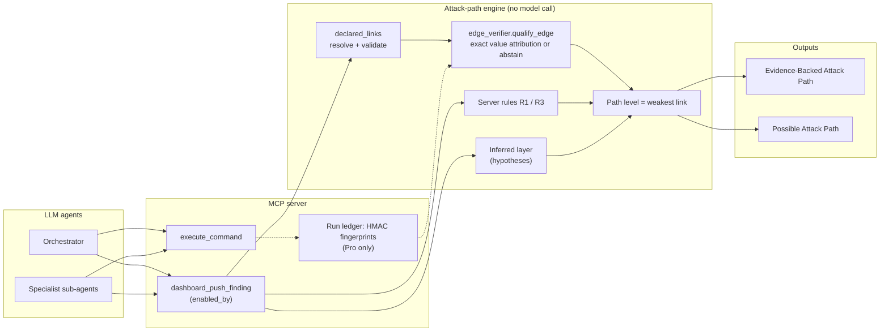

# DarkMoon Attack Paths Research

**Agent-declared attack-path edges, server-side qualification, and what they can and cannot show.**

Version 1.0.0 · 2026-11-20 · English · [AGPL-3.0](LICENSE) · [Cite this work](CITATION.cff)

[Explore the architecture](docs/architecture/README.md) · [Read the research](research/README.md) · [View the benchmarks](benchmarks/README.md) · [Understand the evidence model](docs/causal-model/README.md) · [Try DarkMoon Community](https://github.com/ASCIT31/Dark-Moon) · [Explore the live demo](https://demo.dark-moon.org) · [Read the related articles](#8-publications-and-related-articles)

---

## 1. Presentation

DarkMoon is an autonomous AI penetration-testing system: an orchestrator and specialist LLM agents run tools against an authorised target and publish **findings**. This repository documents how DarkMoon links those findings into **attack paths**, how that design evolved between October 2025 and November 2026, and what the experiments actually measured.

It is a research record, not a product brochure. It keeps the negative results, labels every statement by its evidence (`VERIFIED`, `OBSERVED`, `SIMULATED`, `HYPOTHESIS`, `SUPERSEDED`, `UNKNOWN`), and states plainly what has not been demonstrated. The code of the open-source edition is in [ASCIT31/Dark-Moon](https://github.com/ASCIT31/Dark-Moon); DarkMoon Pro is proprietary and is cited as "DarkMoon Pro, internal" with a short commit hash.

## 2. Scientific problem

When LLM agents state that one finding *enabled* another, how can a system decide, **without trusting the agent and without extra model calls**, which of those statements are supported by what the system itself recorded, and how often are they right?

This is distinct from attack-graph generation (deriving potential paths from a network model), from provenance-based intrusion reconstruction (OS audit logs), and from measuring exploitation success (flags, root). It sits between them: **qualifying links between findings produced by an agent**. See [scientific positioning](research/scientific-positioning/README.md).

## 3. Retained architecture (architecture D)

1. **Declare.** On each finding it pushes, an agent may list the earlier findings it used in one optional field, `enabled_by`. Cost: about +0.5 % of a campaign's tokens for the whole mechanism (SIMULATED).
2. **Show at once, as a hypothesis.** The server stores each valid declaration as `declared_by_agent` and displays it immediately as part of a **Possible Attack Path**.
3. **Qualify, or abstain.** The server promotes a link only by **exact value attribution** on its own execution records: a value produced by one recorded execution and consumed by a later successful one, uniquely and in order (`observed_flow`); plus a recorded refused attempt without the value for `causal_necessity_demonstrated`. Otherwise it abstains with one of 14 closed reasons.
4. **Label by the weakest link.** A path is an **Evidence-Backed Attack Path** only if every step is supported by a server rule or qualification; everything else is a **Possible Attack Path** and is never ranked.

In DarkMoon Community there is no execution ledger and agent-written evidence text is withheld from the engine, so **`proven_paths = 0` by construction**. Details: [architecture](docs/architecture/README.md) · [provenance](docs/provenance/README.md) · [agent-native graphs](docs/agent-native/README.md) · [decisions](decisions/README.md).

## 4. System diagram

More diagrams, checked against Dark-Moon [`10eaab0`](https://github.com/ASCIT31/Dark-Moon/commit/10eaab0): [diagrams/](diagrams/README.md).

## 5. Main experiments

61 experiments are published in [experiments/](experiments/README.md), with a per-target synthesis in [experiments/RESULTS.md](experiments/RESULTS.md). The main ones for attack paths:

| Experiment | Hypothesis | Result | Status | Source |
|---|---|---|---|---|
| [EXP-010](experiments/successful/EXP-010.md) | Why does the product almost never show proven paths? (18 real campaigns, 340 findings) | 0/340 findings with causal fields; 5 proven paths, all R3; ranking allowed 0/18 | `VERIFIED` | internal R&D report D27/02 |
| [EXP-015](experiments/failed/EXP-015.md) | Flag-gated fixes yield correct causal paths (dmlab, 14 truth links) | causal-edge recall **0/14** on every run; 9/11 agent-declared links correct but not server-corroborated | `VERIFIED` | internal R&D report D27/07 |
| [EXP-019](experiments/failed/EXP-019.md) | Counterfactual active replay verifies causal links | 9/11 correct, **2 false proven links**; wire flows 20/20 but recall 4/29 | `SIMULATED` | internal R&D report D27/07 |
| [EXP-031](experiments/failed/EXP-031.md) | Active replay yields multi-finding (N4) chains on crAPI | 2 direct exploitations, **0 N4** | `SIMULATED` | internal R&D report D27 (E4) |
| [EXP-038](experiments/failed/EXP-038.md) | "Own command" attribution proves chains | 5 families, then 7 new false proven links | `SUPERSEDED` | internal report R/14 |
| [EXP-039](experiments/failed/EXP-039.md) | A MulVAL-like capability graph links findings | 10/78 edges correct (12.8 %) | `SUPERSEDED` | internal report R/30 |
| [EXP-042](experiments/successful/EXP-042.md) (c5) | Prompt lever raises `enabled_by` fill | 15/39 findings declared; strict precision 0.6 (5 decidable), recall 2/6 | `VERIFIED` | internal report R/50 |
| [EXP-043](experiments/inconclusive/EXP-043.md) (c6) | Agents declare correct links on a multi-protocol chain | strict precision 0.556 [0.27–0.81], recall 5/6 | `VERIFIED` | internal report R/50, R/54 |
| [EXP-047](experiments/adversarial/EXP-047.md) | Architecture D never promotes falsely | harness: 0 false promotions, recall 0.829; real replay **0/25** qualified | `SIMULATED` | internal report R/51 |
| [EXP-050](experiments/failed/EXP-050.md) (c7) | Architecture D on a real multi-protocol campaign | strict precision **0.316 [0.15–0.54]**; server-qualified **0/19**; 12/13 false links "same root cause" | `VERIFIED` | internal report R/54 |
| [EXP-053](experiments/failed/EXP-053.md) | Rewording `enabled_by` cuts same-cause errors | variance ±20 pt > variant differences; keep current text | `SIMULATED` | internal report R/57 |
| [EXP-056](experiments/successful/EXP-056.md) | Final real validation on the lab | 29 findings, 19 declared links, **0 promoted**; ≈ 37 % precision (approximate) | `VERIFIED` | internal report R/60 |
| [EXP-060](experiments/successful/EXP-060.md) | Port to Community | 68 findings, 16 declared links, 17 paths, 0 proven by construction | `VERIFIED` | [Dark-Moon PR #59](https://github.com/ASCIT31/Dark-Moon/pull/59) |

## 6. Measured results

Stated honestly, with the caveat that almost every real-run figure is **n = 1** on one target with one model (claude-opus-4-6):

- **0 server-qualified links on real data.** No declared link has ever reached `observed_flow` on a real campaign (c5/c6 replay 0/25, c7 0/19, final lab run 0/19, DVGA Community 0/16 by construction). Agents mask credentials and the Privacy Gateway tokenises them, so the values needed for exact attribution are absent.
- **Declared-link strict precision 0.6 / 0.556 / 0.316**, single runs (c5 with only 5 decidable links; c6 [0.27–0.81]; c7 [0.15–0.54]). Intervals overlap; no configuration is shown better than another.
- **No proven multi-step chain.** No multi-finding (N4) chain was proven on real data under the strict definition. An earlier "2 proven cross-host chains" claim (2026-11-11) is `SUPERSEDED`: the chains were agent-declared.
- **Non-promotion holds on synthetic scenarios:** 0 false promotions on 100 scenarios / 117 edges, mutation score 95.2 % with 0 permissive survivors (`SIMULATED`).
- **Agents contribute coverage, not proof:** links on protocols the server cannot observe (Redis → PostgreSQL → SSH key), multi-step spines, cross-agent links; dominant error = linking two facets of one root cause.

## 7. Acknowledged limits

- DarkMoon does **not** have a universally reliable causal model; a graph plus an LLM does not demonstrate validated causal intelligence.
- Server pattern rules R1/R3 read agent-written evidence text, not an independent capture; two product strings overstate this and are flagged for correction.
- Stronger model-side privacy and stronger server-side attribution compete for the same evidence; no design resolves this yet.
- Oracles and harnesses were built by the same team; some replays used a proxy model; targets are self-built labs or well-known vulnerable apps; no public benchmark run.
- Several source inconsistencies are recorded, not silently resolved.

Full list: [docs/limitations/](docs/limitations/README.md).

## 8. Publications and related articles

**Articles — coming soon.** No article has been published yet. This section will list them when they exist.

Related earlier work: [ASCIT31/darkmoon-attack-surface-research](https://github.com/ASCIT31/darkmoon-attack-surface-research), research notes on spatial, WebXR-capable attack-surface visualisation.

## 9. Code

- DarkMoon Community (open source, AGPL-3.0): [github.com/ASCIT31/Dark-Moon](https://github.com/ASCIT31/Dark-Moon)
- Attack-path engine at the documented commit: [`mcp/api/`](https://github.com/ASCIT31/Dark-Moon/tree/10eaab0/mcp/api) (`attack_paths.py`, `attack_paths_observed.py`, `declared_links.py`, `edge_verifier.py`, `attack_paths_local.py`)
- Terminal Explorer: [`conf/plugins/darkmoon-explorer/`](https://github.com/ASCIT31/Dark-Moon/tree/10eaab0/conf/plugins/darkmoon-explorer)

## 10. Demo

Live demo: [https://demo.dark-moon.org](https://demo.dark-moon.org)

## 11. Documentation

Product documentation: [https://docs.dark-moon.org](https://docs.dark-moon.org)

## 12. Sister repository

[ASCIT31/darkmoon-visualization-research](https://github.com/ASCIT31/darkmoon-visualization-research) (publishing) — research on how attack paths and evidence are visualised.

---

### Repository map

| Path | Content |
|---|---|
| [docs/](docs/README.md) | architecture, causal model, expert systems, provenance, agent-native graphs, security, limitations |
| [research/](research/README.md) | literature review, scientific positioning, comparisons |
| [experiments/](experiments/README.md) | 61 experiment pages: successful, failed, inconclusive, adversarial |
| [benchmarks/](benchmarks/README.md) | links to the public benchmark repositories |
| [decisions/](decisions/README.md) | ADR-style decision records |
| [diagrams/](diagrams/README.md) | Mermaid diagrams matching the code |
| [screenshots/](screenshots/README.md) | Terminal Explorer captures on synthetic demo data |
| [references/](references/README.md) | BibTeX bibliography |

[Contributing](CONTRIBUTING.md) · [Changelog](CHANGELOG.md) · [Licensing](LICENSING.md) · [Citation](CITATION.cff)
