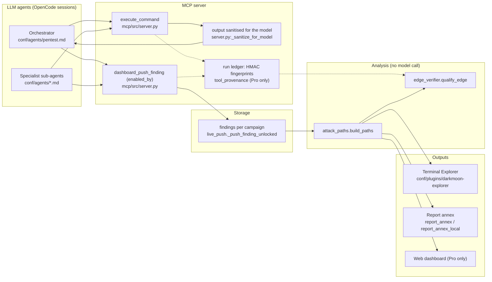

# 01 — System overview

Dashed arrows exist only in Pro: Community has no run ledger (`DM_TOOL_PROVENANCE` is in `FORCED_OFF`, [`mcp/api/feature_flags.py`](https://github.com/ASCIT31/Dark-Moon/blob/10eaab0/mcp/api/feature_flags.py)), so `qualify_edge` finds no facts and every declared link stays `declared_by_agent`.
