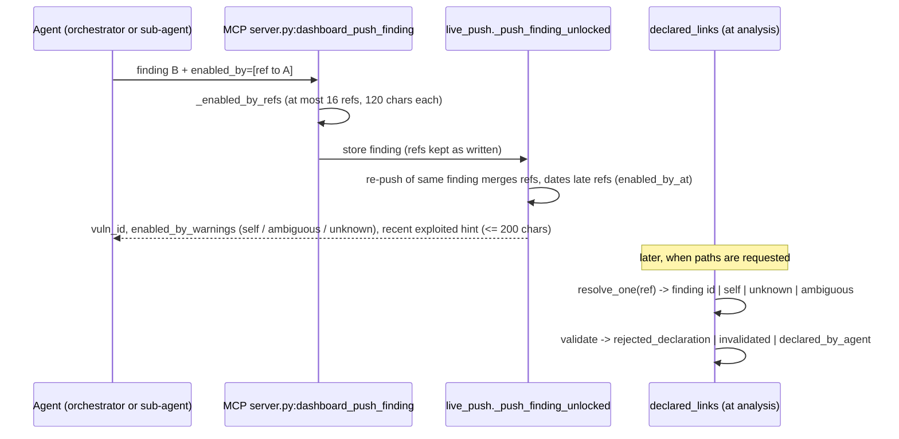

# 02 — Push and declaration

References accepted: `vuln_id`, `dedup_key`, `short_title` or exact endpoint. ATT&CK tactic order is checked as a **warning only**. Code: [`mcp/src/server.py`](https://github.com/ASCIT31/Dark-Moon/blob/10eaab0/mcp/src/server.py), [`mcp/api/live_push.py`](https://github.com/ASCIT31/Dark-Moon/blob/10eaab0/mcp/api/live_push.py), [`mcp/api/declared_links.py`](https://github.com/ASCIT31/Dark-Moon/blob/10eaab0/mcp/api/declared_links.py).
