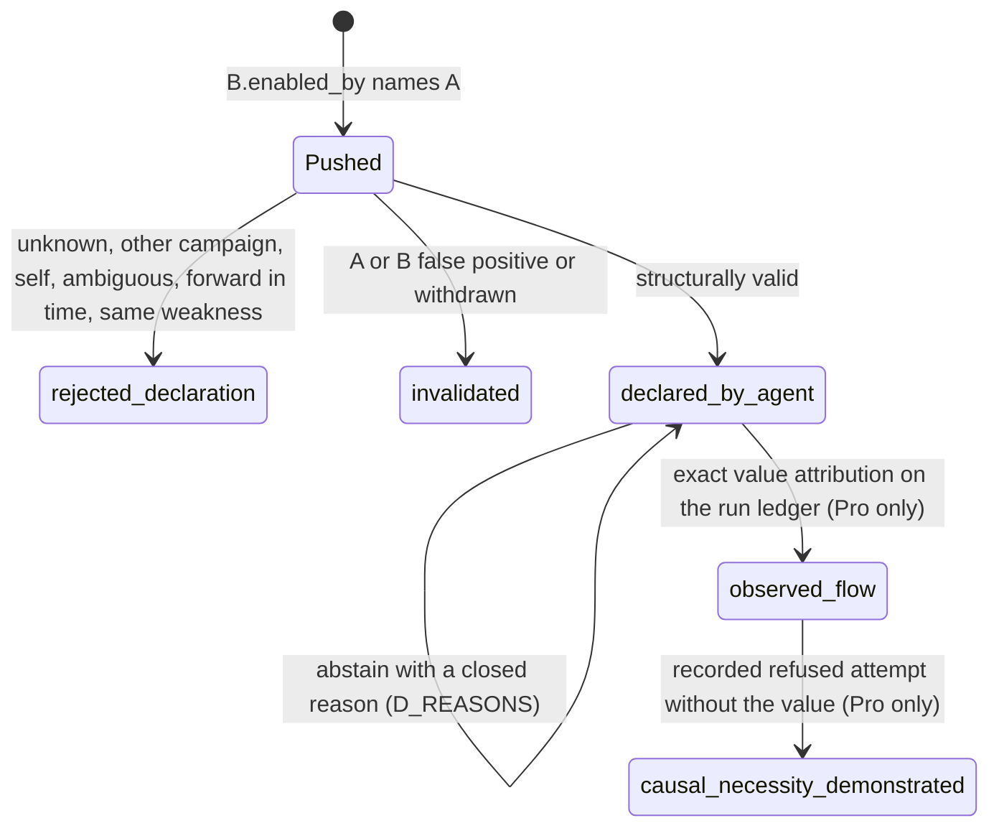

# 03 — Link states

| State | Server label (verbatim, `edge_verifier.D_STATE_LABELS`) |
|---|---|
| `declared_by_agent` | Declared by the agent · not verified by the server |
| `observed_flow` | Observed flow — the server recorded the value flowing from A's execution to B's successful execution |
| `causal_necessity_demonstrated` | Necessity demonstrated — refused without the value, accepted with it, both recorded |

Abstention reasons (`D_REASONS`): `not_declared`, `duplicate_finding`, `cross_run`, `finding_not_live`, `missing_data`, `run_compacted`, `session_unknown`, `no_shared_value`, `value_not_consumed`, `execution_after_push`, `ambiguous_origin`, `exogenous_value`, `several_findings`, `consumer_not_success`. Code: [`mcp/api/edge_verifier.py`](https://github.com/ASCIT31/Dark-Moon/blob/10eaab0/mcp/api/edge_verifier.py).

On every real campaign measured so far, **0** declared links reached `observed_flow` (see [`../experiments/RESULTS.md`](../experiments/RESULTS.md) §9.4).
