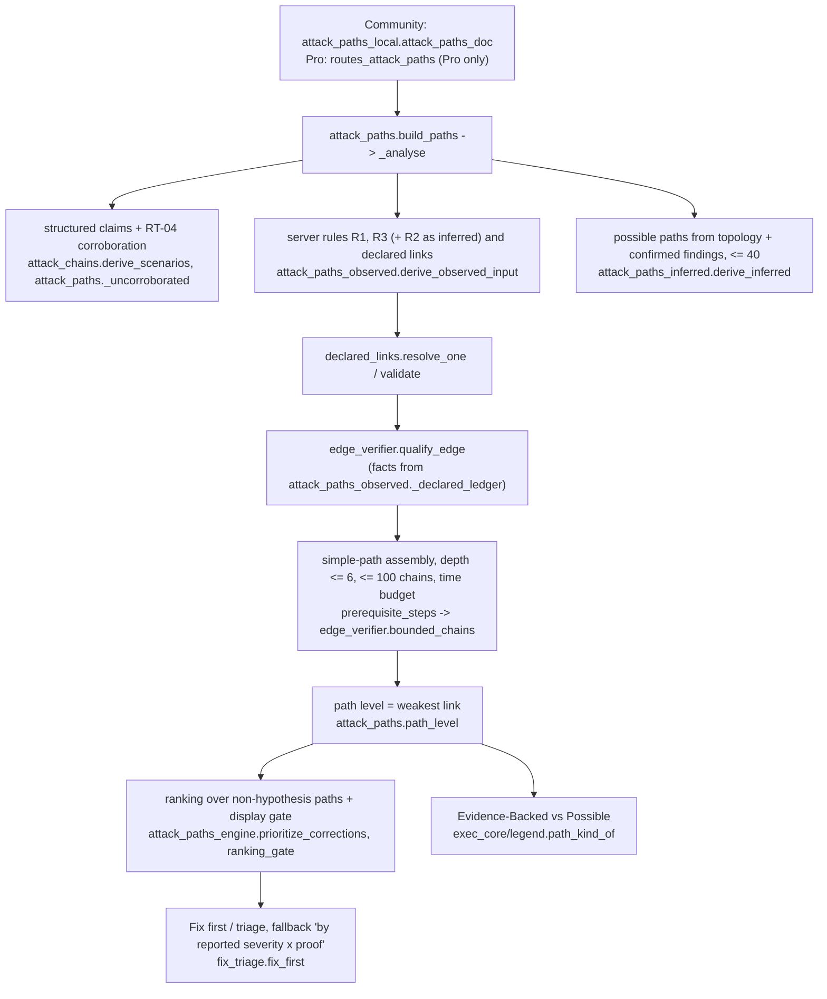

# 04 — Path analysis

Level order: `inferred` < `declared_by_agent` < `observed_flow` < `observed` (R1/R3) < `causal_necessity_demonstrated`. A path with any `declared_by_agent` or `inferred` step is a **Possible Attack Path** (`hypothesis: true`) and is never ranked. Code: [`mcp/api/attack_paths.py`](https://github.com/ASCIT31/Dark-Moon/blob/10eaab0/mcp/api/attack_paths.py), [`attack_paths_observed.py`](https://github.com/ASCIT31/Dark-Moon/blob/10eaab0/mcp/api/attack_paths_observed.py), [`attack_paths_inferred.py`](https://github.com/ASCIT31/Dark-Moon/blob/10eaab0/mcp/api/attack_paths_inferred.py), [`fix_triage.py`](https://github.com/ASCIT31/Dark-Moon/blob/10eaab0/mcp/api/fix_triage.py), [`exec_core/legend.py`](https://github.com/ASCIT31/Dark-Moon/blob/10eaab0/mcp/api/exec_core/legend.py).
