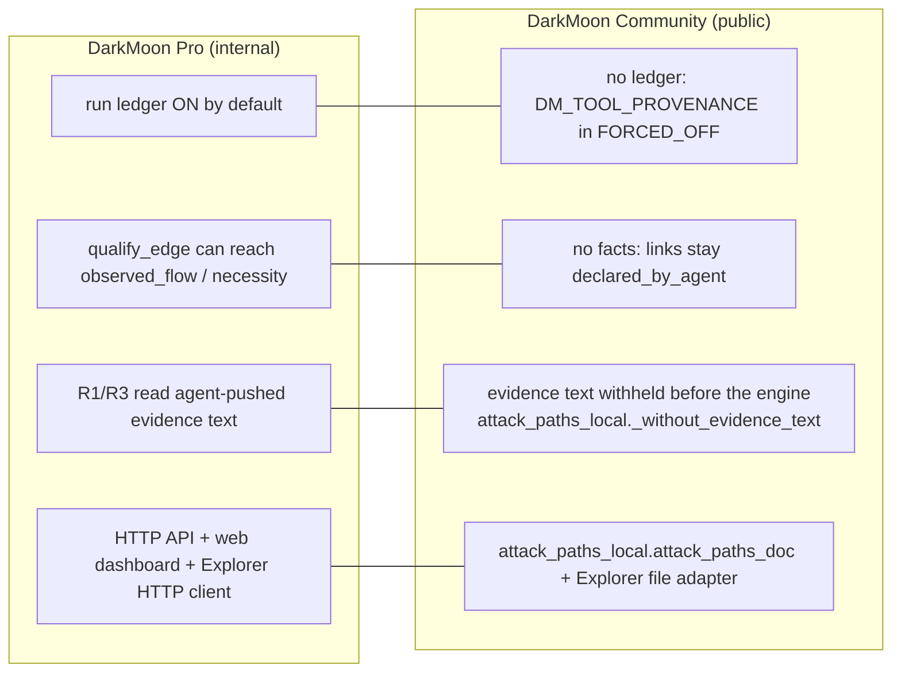

# 05 — Community vs Pro

Shared: schema `darkmoon-attack-paths/v1` and the engine modules (`attack_paths*.py`, `declared_links.py`, `edge_verifier.py`, `live_push.py`). Community forces off `DM_LEGACY_DERIVED_PROOF`, `DM_FINALIZE_CHAINS_AS_PATHS`, `DM_ARTIFACT_FINGERPRINTS`, `DM_TOOL_PROVENANCE`, and replaces evidence text with "[agent-written evidence: not used as proof]". Result: **`proven_paths = 0` by construction** in Community. Code: [`attack_paths_local.py`](https://github.com/ASCIT31/Dark-Moon/blob/10eaab0/mcp/api/attack_paths_local.py), [`feature_flags.py`](https://github.com/ASCIT31/Dark-Moon/blob/10eaab0/mcp/api/feature_flags.py).
