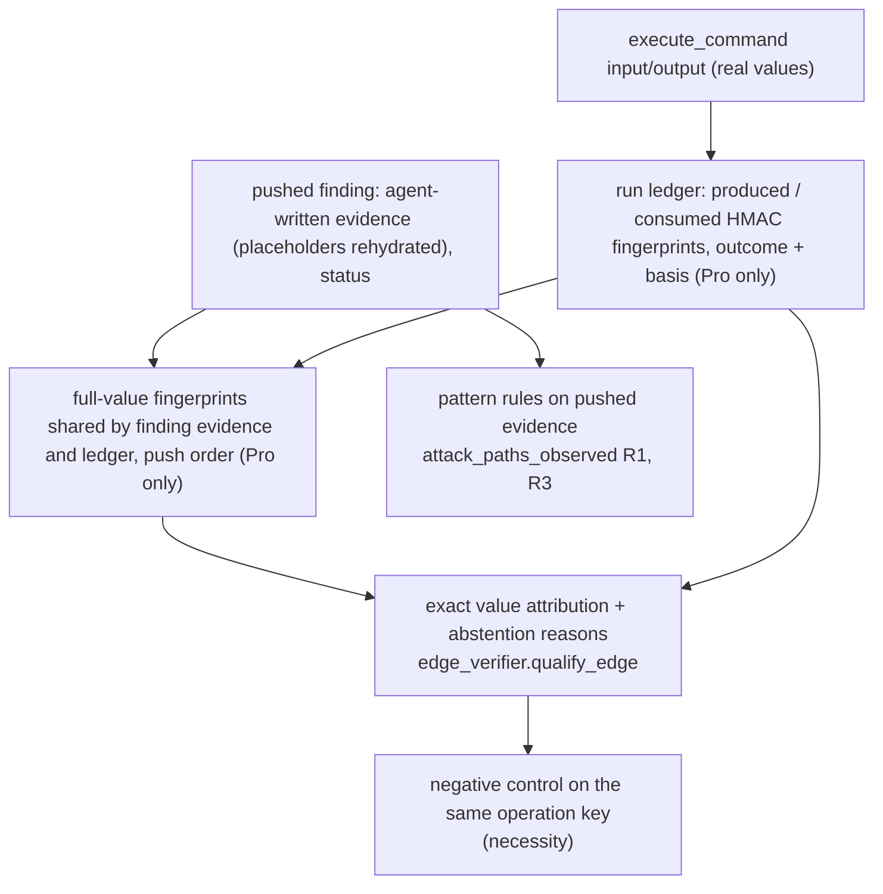

# 06 — Evidence model

Success needs `http_2xx` or `exit0_expected_output`; refusal needs `http_refused` or `refusal_signature`; `exit 0` alone is `unknown`. **R1 and R3 read the agent-written evidence, not an independent capture**; only `qualify_edge` reads the independent ledger. See [`../docs/provenance/`](../docs/provenance/README.md).
