# Agent-native attack graphs in DarkMoon: what LLM agents actually contribute

Status: public research documentation, version 1.0.0, 2026-11-20. Reconstructed read-only from code and internal reports. English. Conventions, labels and code references are as in [`ATTACK-PATHS-ARCHITECTURE`](../architecture/README.md) §0:
- **Pro** = DarkMoon Pro, private repository, internal `d6bfc0d9`;
- **Community** = public [Dark-Moon `10eaab0`](https://github.com/ASCIT31/Dark-Moon/commit/10eaab0);
- `R/` = internal report archive;
- `EXP-nnn` = forensic experiment registry.

## 1. Definition used here

An **agent-native** attack graph is one whose edges are *declared by the LLM agents while they work*, in the tool calls they already make. It is not:
- reconstructed afterwards by a server from logs or text;
- extracted by a second LLM;
- derived from a fixed rule base.

In DarkMoon the declaration is a single optional list, `enabled_by`, on `dashboard_push_finding`:
- its nodes are the findings;
- each element of `B.enabled_by` is a directed edge `A → B`, meaning "B's exploitation used a result obtained in A".

[VERIFIED: `mcp/src/tool_param_docs.py:ENABLED_BY`, `mcp/api/declared_links.py`]

The "classic structured representation" it is compared with is the family of graphs DarkMoon tried or considered:
- topology graphs;
- precondition / postcondition graphs, such as MulVAL-like capability graphs or the CHAIN DATA fields;
- server-observed data-flow graphs (R1/R3, the run ledger);
- standards such as MITRE Attack Flow, STIX relationships, W3C PROV and BloodHound OpenGraph, considered as **export** formats only.

[VERIFIED: R/50 OPEN-SOURCE-COMPARISON.md; R/30 (method watch) round 1]

## 2. Why DarkMoon ended up agent-native

1. **Structured claims were not filled.**
   - 0 of 340 findings carried any causal field (18 campaigns).
   - The four CHAIN DATA fields were filled 0 of 51 times on a real campaign.
   - Specialists, who push about 96 % of findings, had never been instructed to fill them.

   [VERIFIED: D27/02_root_cause.md; `server.py` comment; EXP-010]
2. **Server-side reconstruction guessed.**
   - Architecture A had 20 guessing rules (endpoint, host+service, push order, mention).
   - It made at least one wrong binding on two real campaigns.
   - R4 "own command" produced false proven links in two review rounds.

   [VERIFIED: R/40 00-baseline.md; R/14]
3. **Rule bases did not generalise.**
   - Capability graph: 10 of 78 edges correct.
   - Rules on finding text: 12–15 % held-out precision.

   [SIMULATED: [EXP-039](../../experiments/failed/EXP-039.md), EXP-040]
4. **Token budget.**
   - The product owner cap is +1 % of a campaign's tokens.
   - Asking the agent for execution ids on every command cost +1.02 % / +1.75 %.
   - The `enabled_by` *values* cost about +0.04–0.08 %.
   - The whole current mechanism (schema, prompt lines, `recent_exploited` hint) costs about +0.52–0.57 %.

   [SIMULATED: [EXP-046](../../experiments/successful/EXP-046.md), R/50 TOKEN-COST-MODEL.md §0. The error band is −20/+25 % of the overhead; an exact `count_tokens` recount was never done (R/51 FINAL-DECISION.md, R/54 §7): **UNKNOWN** exactly]

A short `enabled_by` list was the cheapest relation the agent would actually fill. It was filled on 22 of 50 findings (c5 + c6) with **0 invented ids**. [VERIFIED: R/50 FINAL-RECOMMENDATION.md]

## 3. The model in code

```mermaid
flowchart LR
  A["Agent pushes B with enabled_by=[A]<br/>mcp/src/server.py:dashboard_push_finding"]
  S["Store as written, merge on re-push, warnings<br/>mcp/api/live_push.py:_push_finding_unlocked"]
  R["Lazy resolution at analysis<br/>mcp/api/declared_links.py:resolve_one"]
  V["Structural validation; ATT&CK = context<br/>mcp/api/declared_links.py:validate"]
  D["Edge state declared_by_agent (shown at once)"]
  Q["Zero-token qualification on server records<br/>mcp/api/edge_verifier.py:qualify_edge"]
  P["Simple-path assembly, level = weakest edge<br/>edge_verifier.py:bounded_chains; attack_paths.py:path_level"]
  A --> S --> R --> V --> D --> Q --> P
```

**Properties.** [VERIFIED unless marked]

- **Branches.** `[A1, A2]` gives two edges. There is no AND/OR semantic in the declaration; the engine treats alternatives as OR in its ranking model (`attack_paths_engine.py`).
- **Empty list.** An empty list means an entry point.
- **Late additions.** A re-push with more references merges them and dates each one (`enabled_by_at`). A reference to a finding pushed *after* the declaration is a `rejected_declaration` ("forward").
- **Corrections.** These are made by the operator (UI or API) or through finding status: false positive or withdrawn makes the link `invalidated`. The agent has no "unlink" call.
- **Cross-agent references.** These are allowed and resolved campaign-wide.
- **Protocol-agnostic by construction.** `declared_links.py` reads no protocol data; only qualification depends on what the server could observe.
- **No relation type.** A typed variant (`DIRECT / SAME_CAUSE / CONTEXT / NONE`) was tested in simulation and not adopted ([EXP-053](../../experiments/failed/EXP-053.md)).

## 4. What the agents actually contribute

### 4.1 Contributions that no structured component produced

| Contribution | Evidence | Label |
|---|---|---|
| **Relations on protocols the server cannot observe** (Redis → PostgreSQL → file read → SSH key, SMB, PostgreSQL-only chains) | c6, c7 and the final lab run declared multi-protocol links; server observation (R1/R3, tap, pcap) is effectively HTTP-only | VERIFIED: R/54 CYCLE2-CAMPAIGN7.md; R/60 LAB-PENTEST.md; an internal topic-evidence note §3 ("observation-proven paths are in practice HTTP-only") |
| **Coverage of the real chain spine (recall)** | Strict recall: 2/6 (c5), 5/6 (c6), 6/9 (c7; 9/9 by reachability) | VERIFIED: [EXP-042](../../experiments/successful/EXP-042.md), [EXP-043](../../experiments/inconclusive/EXP-043.md), [EXP-050](../../experiments/failed/EXP-050.md) |
| **Multi-step chains** | Complete chains (≥ 3 findings, ≥ 2 valid links): 2 in c6, 3 in c7 | VERIFIED: R/54 §9 |
| **Cross-agent links** | c7: 4 of 7 expected cross-agent links declared; ids crossed boundaries through orchestrator delegation prompts and task results | VERIFIED: R/54 CYCLE2-CAMPAIGN7.md |
| **Zero extra inference** | Declarations ride on the existing push; no extra LLM call or tool | VERIFIED: code; R/50 |
| **No invented identifiers** | 0 invented ids on 50 findings (c5 + c6); 0 rejected references on DVGA (16 of 68 findings declared) | VERIFIED: R/50; R/66 07-DVGA.md |

### 4.2 What the agents get wrong

These are the measured error classes against independent oracles, all on single real runs (n = 1 per configuration). [VERIFIED: R/50 MINIMAL-ARCHITECTURE.md §1; R/55 PHASE1-SAME-CAUSE-ANALYSIS.md]

- **Same root cause ("facet") links.**
  - Two findings that share one weakness are declared as an enabling chain. Examples: SLAVEOF / CONFIG SET / EVAL ← unauthenticated Redis; user enumeration ← SMB null session.
  - In c7 this was 12 of 13 false links, all from **sub-agents**. The orchestrator made 0 such errors in c6 and c7.
- **Precondition treated as progression.** A version-matched CVE, `confirmed` but not exploited, is linked to the unauthenticated service it would need.
- **"Revealed" treated as "enabled".**
- **State finding cited instead of the access step.** For example, "app is superuser" is cited where the login gave the access.
- **Transitive or ancestor errors.** The agent cites an earlier ancestor instead of the direct parent (c6: 3 of 4 false positives).
- **Omission of the immediate parent.** This is linked to the `recent_exploited` hint, which earlier omitted the finding just pushed. The hint was reordered in D; the effect of that reorder is unmeasured. [UNKNOWN: R/51 FINAL-DECISION.md]
- **Anchoring on content offered in the context.** The delegation prompt and the hint name the root weakness of the delegated service. In c7, 0 citations followed the hint's #1 position when it was wrong, so this is content anchoring, not position anchoring. [VERIFIED: R/55 §1–2]

**Precision.**

| Campaign | Strict precision | Notes |
|---|---|---|
| c5 | 0.6 | 5 decidable of 16 |
| c6 | 0.556 [0.27–0.81] | |
| c7 | 0.316 [0.15–0.54] | |
| final lab run | ≈ 0.37 | approximate scoring |

Hallucination on declared links was 6–11 % (c5/c6). [VERIFIED: [EXP-042](../../experiments/successful/EXP-042.md), [EXP-043](../../experiments/inconclusive/EXP-043.md), [EXP-050](../../experiments/failed/EXP-050.md); OBSERVED: [EXP-056](../../experiments/successful/EXP-056.md) approximate]

### 4.3 What the agents do not contribute

- **Evidence that a link is real.** The declaration is the agent's opinion. The server qualified **0** declared links on c5/c6 (0 of 25), c7 (0 of 19), the final lab run (0 of 19), DVGA Community (0 of 16, Community cannot qualify) and today's DVGA runs (see [`ATTACK-PATHS-EXPERIMENTS`](../../experiments/RESULTS.md) §8.2). [VERIFIED / SIMULATED as marked there]
- **Values the server could attribute.**
  - Agents mask credentials in their pushed evidence (`***`).
  - The Privacy Gateway already replaced them with placeholders the agent rarely re-types into a push: 0 non-host placeholders in 50 real pushes.
  - Exact value attribution therefore finds nothing on real data. [VERIFIED: R/52 PROVENANCE-STUDY.md; R/51 SERVER-ATTRIBUTION.md]
- **Stable behaviour.**
  - Run-to-run variance is about ±17–20 points between passes of the *same* variant on the same corpus.
  - Real cost varied +53 % between c6 and c7 with similar prompts.
  - No prompt change could be shown useful outside the data that suggested it. [SIMULATED: R/55 §6, R/57 RESULTS.md; VERIFIED: R/58 COST-COMPARISON.md]

## 5. Agent-native vs classic structured representation

| Dimension | Agent-native `enabled_by` (D) | Server-observed data flow (R1/R3, ledger, C) | Rule / capability graph (MulVAL-like, text rules) | Structured claims (CHAIN DATA) |
|---|---|---|---|---|
| Who creates edges | acting agent, in its push | server, from records or pushed evidence | fixed rules over findings | agent, filling 4 typed fields |
| Fill rate on real runs | 15/39 (c5), 7/11 (c6), 19/28 (c7), 16/68 (DVGA-Com) [VERIFIED] | R1 0 and R3 5 in 18 campaigns [VERIFIED: D27/02] | n/a (always produces) | 0/340, 0/51 [VERIFIED] |
| Precision vs oracle | 0.32–0.6 (n = 1 each) [VERIFIED] | high by construction when it fires; harness 0 false promotions [SIMULATED]; real: rarely fires | 12.8 % edges (capability graph), 12–15 % (text rules) [SIMULATED] | not measurable (empty) |
| Protocol coverage | any | effectively HTTP; ledger generic but needs full values | depends on rule base | any |
| Token cost | ≈ +0.5 % (whole mechanism) [SIMULATED] | 0 (server) unless ids shown to agent (+1–1.75 %) [SIMULATED] | 0 | small, but unused |
| Failure mode | plausible but wrong links (same cause) | silent abstention | systematic false edges | silence |
| Status in product | shown at once as **Possible** (`declared_by_agent`) | **Evidence-Backed** when every step qualifies | not used (NO-GO) | hidden from schema; legacy accepted |

[HYPOTHESIS: the comparison rows synthesise the cited measurements; the samples are small and not on the same targets]

**Reading the table.**
- The agent is a **high-recall, low-precision proposer** that costs little.
- The server is a **near-zero-recall, high-precision verifier** on real data.
- DarkMoon keeps both and labels them separately. It never adds them together into a single "proven" count. [VERIFIED: `attack_paths.py:path_level`, `exec_core/legend.py:path_kind_of`]

## 6. What was tried to improve agent declarations, and the outcome

| Lever | Change | Result | Decision | Label |
|---|---|---|---|---|
| Sub-agent prompt line + `recent_exploited` reply (lever 1) | `33714381`, `136dbccc` | fill 4/36 → 15/39 (c4 → c5, different conditions, n = 1) | kept | VERIFIED: [EXP-041](../../experiments/successful/EXP-041.md), [EXP-042](../../experiments/successful/EXP-042.md) |
| Hint reorder (own just-pushed finding first) | arch D | effect unmeasured | kept | UNKNOWN |
| Wording "the direct step actually used" (+54 chars) | `e44ceba8` | c7: 31.6 % vs c6 55.6 %, intervals overlap; transitive errors 3 → 0 but 12 same-cause errors appeared (sub-agents) | **reverted** `cbc4df04` | VERIFIED: [EXP-050](../../experiments/failed/EXP-050.md) |
| V3 variant B (clarify "obtained by exploiting it; not a finding sharing its root cause") | none | c7 replay V0 27 % → B 78 %; hard independent corpus V0 91.2 % → B 79.4 % | not applied | SIMULATED: [EXP-051](../../experiments/failed/EXP-051.md) |
| Micro-test V1 (mental qualification) / V2 (typed labels) | none | independent subset: all 100 %; c7: V0 36 %, V1 33 % (lost 2 true links), V2 40 %; variance ±20 pt | keep V0 | SIMULATED: [EXP-053](../../experiments/failed/EXP-053.md) |
| Orchestrator copies ids into delegation | (agent behaviour) | observed spontaneously in c7; also seeds same-cause anchoring | not engineered | VERIFIED: R/55 §1 |

**Why the simulations are weak evidence.**
- The simulators were Claude Code sub-agents: a different model from the campaign model, with a shorter context and a neutral prompt.
- The fidelity check on c7 was good (28.6 % simulated vs 31.6 % real).
- The independent corpora did not reproduce the real failure mode: 0 same-cause errors on synthetic transcripts.

[SIMULATED: R/55 §6, §10]

## 7. Position

1. In DarkMoon, agent-native graphs are a **declaration layer**, not a proof layer. Each edge is a hypothesis that comes with its author (`discovered_by_agent` of the consumer) and its time (`enabled_by_at`). [VERIFIED]
2. On real data the agents' contribution is **coverage**: protocols, multi-step spines, cross-agent links. That coverage comes at roughly one-third to two-thirds strict precision on the few runs scored. [VERIFIED, n = 1 per run]
3. The combination of LLM declarations, the graph engine and server qualification has **not** been shown to produce validated causal chains on real targets. All real-world promotions so far = 0. See [`CAUSALITY-AND-EVIDENCE`](../causal-model/README.md). [VERIFIED]
4. Further prompt engineering was not supported by evidence (two NO-GO studies). The documented next test is a real A/B with at least 3 campaigns per arm (≈ USD 55); it has not been authorised or run. [OBSERVED: R/55 "Proposed real validation"; status UNKNOWN beyond 2026-11-20]
