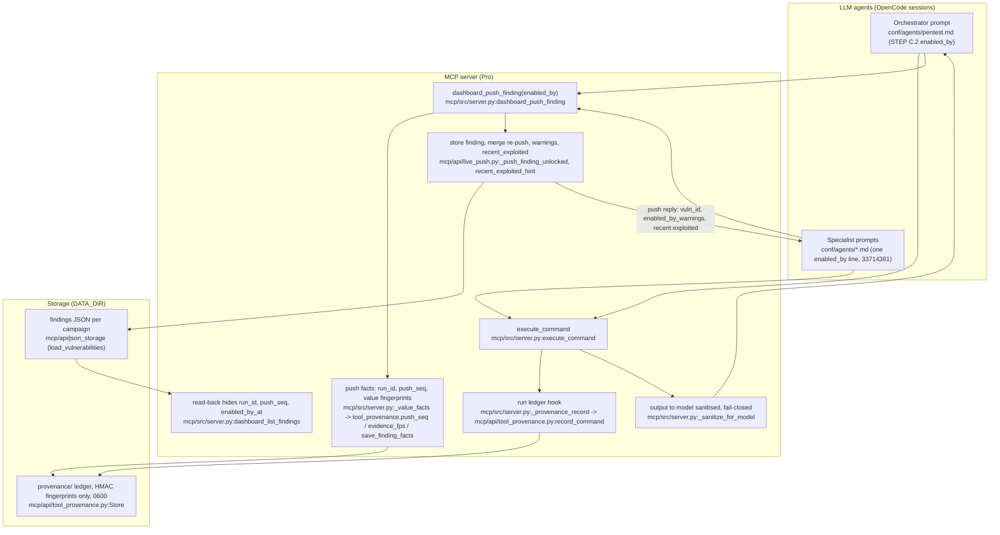
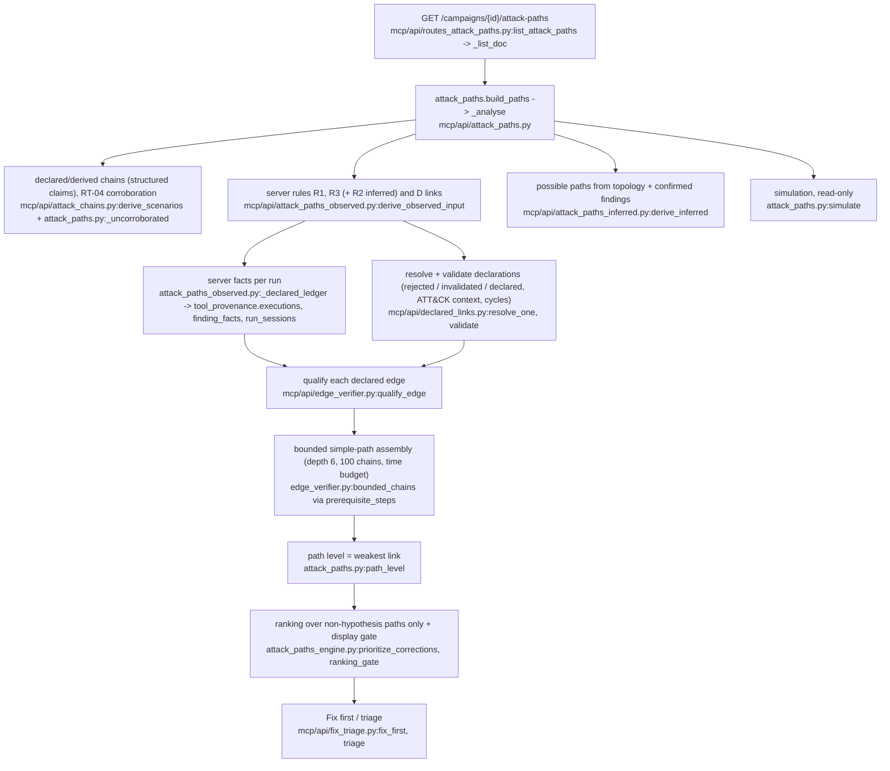
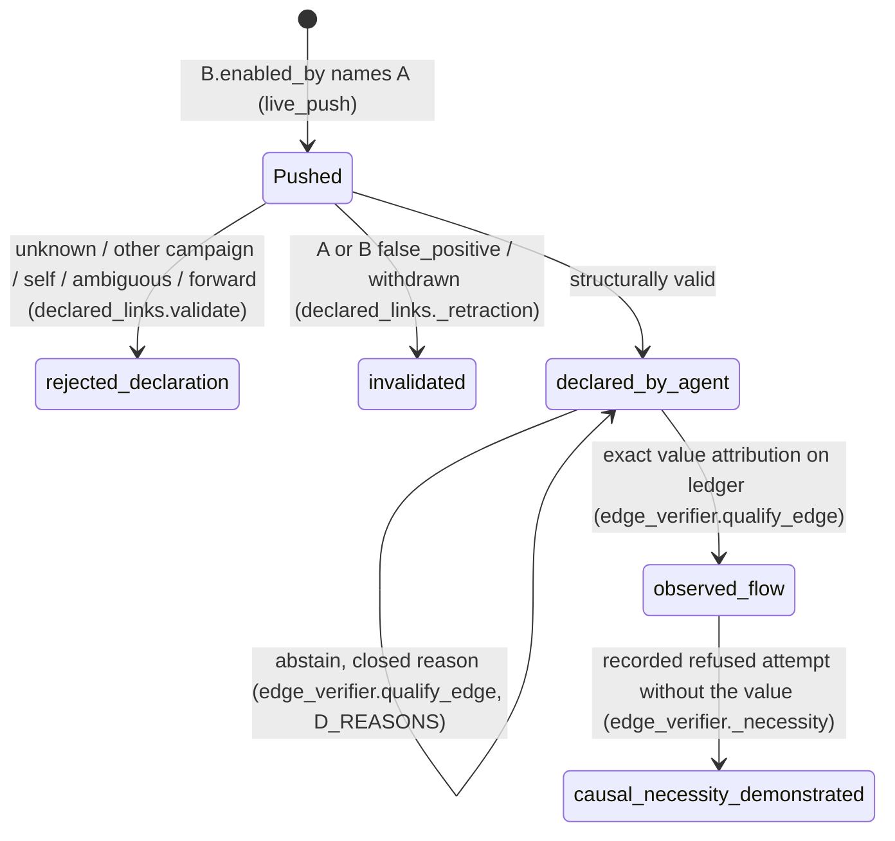
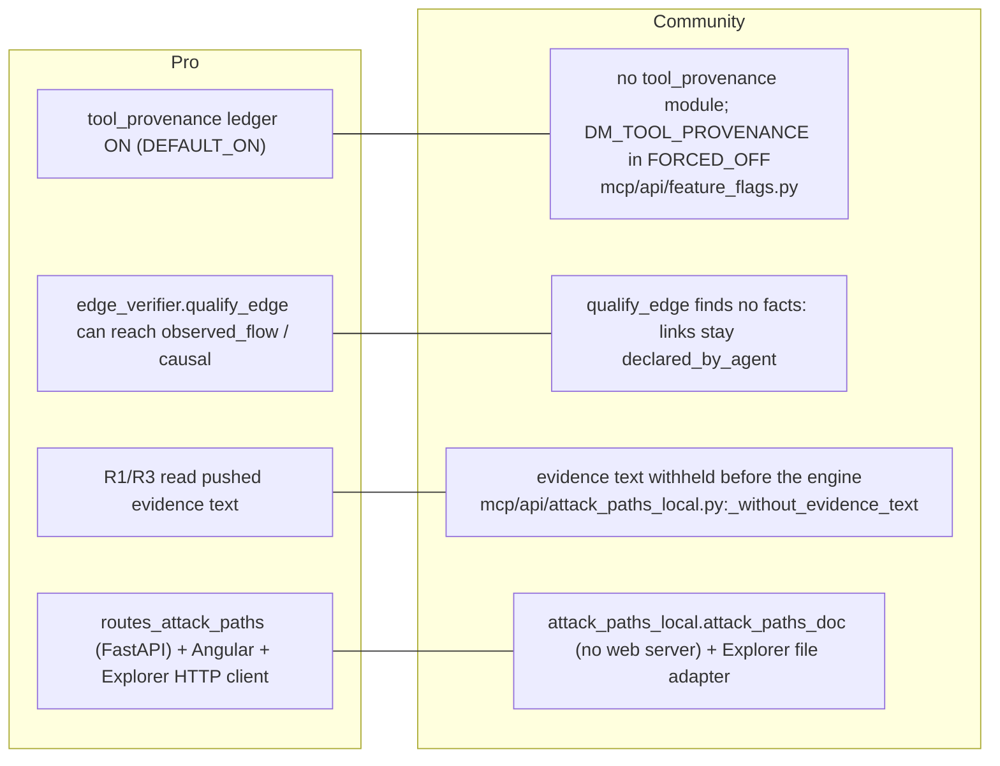

# DarkMoon attack paths: architecture history and current architecture D

Status: public research documentation, version 1.0.0, 2026-11-20. Reconstructed read-only from code and internal reports. English.
Companion files: [`AGENT-NATIVE-GRAPHS`](../agent-native/README.md), [`CAUSALITY-AND-EVIDENCE`](../causal-model/README.md), [`ATTACK-PATHS-EXPERIMENTS`](../../experiments/RESULTS.md).
Inputs: an internal forensic reconstruction (timeline, experiment registry = `EXP-nnn`, decision traceability) and the repository inventory. Public experiment pages: [`experiments/`](../../experiments/README.md); public decision records: [`decisions/`](../../decisions/README.md).

## 0. Conventions

**Code references.**
- **Pro** means DarkMoon Pro, a private repository (API + MCP + Angular). Its production branch was read at `d6bfc0d9` (2026-11-20). Pro code is cited as "DarkMoon Pro, internal" with a short commit hash; it is not linkable.
- **Community** means the public engine repository [ASCIT31/Dark-Moon](https://github.com/ASCIT31/Dark-Moon), read at [`10eaab0`](https://github.com/ASCIT31/Dark-Moon/commit/10eaab0) (2026-11-20). The attack-path modules named below exist in both editions unless marked Pro-only.
- Code is cited as `module/path.py:function` plus the commit. The module path is a component name inside the repository; no long private excerpt is reproduced.

**Report references.**
- `R/nn-…` is the internal engineering report archive. It is not public, and its numbering follows the forensic timeline.
- `D27/…` is the internal "Darkmoon 2027" R&D programme documentation (P0–P9, CF, E3/E4).
- Both are cited for traceability only.

**Status labels.** Every statement carries one label:

| Label | Meaning in this document |
|---|---|
| **VERIFIED** | Checked directly in code at the refs above, or in a primary report cross-checked with a second artefact (registry `VERIFIED`, commit, data file). |
| **OBSERVED** | Stated in one primary source (a report, a commit message) and not re-executed here. |
| **SIMULATED** | Deterministic harness, replay, synthetic corpus, or a proxy model (Claude Code sub-agents). **Never** agent-declaration precision on a real run. |
| **HYPOTHESIS** | An interpretation by this documentation, or a claim no source tested. |
| **SUPERSEDED** | Behaviour or claim replaced by later work. It is kept for history. |
| **UNKNOWN** | The evidence was not available. |

**Two standing rules.**
- Finding counts are **never comparable across targets** (Juice Shop, crAPI, DVGA, dmlab, multi-protocol lab).
- Deterministic-harness scores are **not** agent-declaration precision.

---

## 1. One-paragraph summary

DarkMoon's attack-path work moved from isolated findings, through server-side guessing and several deterministic or counterfactual verification engines, to the current **architecture D**:
- the LLM agents declare, on each finding they push, which earlier findings they used (`enabled_by`);
- the server stores and displays each declaration at once as **`declared_by_agent`**;
- the server never promotes a declared link unless an exact value attribution on its own execution records supports it (`observed_flow`, or `causal_necessity_demonstrated` with a recorded negative control).

On every real campaign measured so far, the server qualified **0** declared links [VERIFIED: R/51 SERVER-ATTRIBUTION.md, R/54 FINAL-AUTONOMOUS-VALIDATION.md §11, R/60 LAB-PENTEST.md].

Measured declaration quality against an independent oracle is modest and unstable:
- c5: 0.6;
- c6: 0.556;
- c7: 0.316 [0.15–0.54].

[VERIFIED: [EXP-042](../../experiments/successful/EXP-042.md), [EXP-043](../../experiments/inconclusive/EXP-043.md), EXP-050]

The product therefore shows mostly **Possible Attack Paths** (hypotheses). An **Evidence-Backed Attack Path** appears only when a server rule or qualification supports every link. DarkMoon does not have a universally reliable causal model (see [`CAUSALITY-AND-EVIDENCE`](../causal-model/README.md)).

---

## 2. History of approaches

Each step below gives: what was tried, why, what happened, the decision, and sources. The order is chronological. Chronology is not causality: a step "answers" an earlier one only when a commit message or report says so.

### 2.1 Isolated findings (Oct 2025 – Sep 2026)

**Approach.**
- Findings were produced by the orchestrator and its specialists and written into markdown reports (first commit `92d5a4c`, 2025-10-29).
- From 2026-06-12 they were also pushed into a dashboard store through `dashboard_push_finding`. The findings-persistence pipeline was ported Pro → Community in COM [`9ad46e6`](https://github.com/ASCIT31/Dark-Moon/commit/9ad46e6).

[VERIFIED: forensic timeline §1, §6]

**Limit.**
- There was no notion of a relation between findings, beyond the narrative in the markdown report.
- Prioritisation was by reported severity and proof status only. This is still the fallback "By reported severity × proof" triage in `mcp/api/fix_triage.py` (`BASIS = "reported-severity-x-proof"`).

[VERIFIED: Pro d6bfc0d9]

### 2.2 First linking attempts: topology and deterministic attachment (Sep – Oct 2026)

**Approach.**
- `0f143981` (2026-09-26) added the orbital WebXR infrastructure graph, together with a "deterministic finding attachment and attack paths" feature.
- Links were drawn from the infrastructure topology: breadth-first paths between nodes, plus findings attached to nodes.

[VERIFIED: commit subject]

**What happened.**
- On 18 real production campaigns, `/infrastructure` returned 43 topological BFS paths.
- The Angular code read **none** of them.
- 22 % of findings were attached through an application fallback, with up to 31 of 35 findings stacked on one node (cause C6).

[VERIFIED: D27/02_root_cause.md §0, §3]

**Decision.** Topology alone was not kept as an attack-path source. It survives as:
- the infrastructure map;
- the **inferred** layer (§2.6).

### 2.3 Attack graphs from structured agent claims and observed evidence rules (Oct 29 – Nov 3, 2026)

**Approach.** Three ingredients:
1. `926f983c` (2026-10-29) exposed optional **CHAIN DATA** fields on `dashboard_push_finding`: `prerequisites`, `produced_artifacts`, `reached_assets`, `negative_control`. It also exposed a `darkmoon-attack-chains/v1` block at finalisation.
2. The front-end "Refonte Eclipse" added an **observed-path adapter** with rules R1/R2/R3 (`4d0786f3`). A read-only analysis service followed, under the rule "real = observed only, demo isolated, gated ranking" (`6ab37775`), plus server scenario ranking (`01f04104`).
3. `a5e9cd18` (2026-11-03) created the server engine and schema `darkmoon-attack-paths/v1`:
   - `mcp/api/attack_paths.py`;
   - `attack_paths_engine.py`;
   - `attack_paths_observed.py` (the Python port of the front-end derivation);
   - `attack_chains.py`.

[VERIFIED: commit subjects; file creation dates via `git log --diff-filter=A`]

**Rules, as still documented in `attack_paths_observed.py` (module docstring).**
- **R1 artefact.** A typed secret appears in A's output, not in A's input, and is presented as a credential in B's executable input.
- **R2 mechanism.** Open registration matched by endpoint. It is now demoted (§2.10).
- **R3 reach.** An exploited finding's response proves access to *another* node, such as a system account file or SQL rows plus a named engine.

[VERIFIED: Pro d6bfc0d9]

**What happened.** The Darkmoon 2027 diagnosis covered 18 real campaigns and 340 findings ([EXP-010](../../experiments/successful/EXP-010.md)):

| Measure | Result |
|---|---|
| Findings carrying any causal field | 0 / 340 |
| Finalisation chain blocks | 0 / 18 |
| Traced push calls with a causal key | 0 / 24 |
| R1 / R2 / R3 links | 0 / 1 / 5 |
| Proven paths | 5, all R3 |
| Campaigns where ranking was allowed | 0 / 18 |

[VERIFIED: D27/02_root_cause.md:11-22]

Root causes, confirmed by the diagnosis:
- **C1.** Specialists (50 of 51 pushing prompts) were never instructed to fill the causal fields.
- **C2.** Pivot evidence is truncated or masked, so no verbatim transposition can be shown.
- C3–C6 are listed in the same source.

[VERIFIED: D27/02_root_cause.md §3]

**Decision.** The engine was kept, and the Darkmoon 2027 programme started (§2.5). Separately, operator-declared paths were added on 2026-11-04 (`506f390e`): admin-only, audited, outside the engine, and always worded "Declared by operator · not proven". [VERIFIED: commit subject; `client-app/src/app/campaign/declared-paths.ts` header]

### 2.4 Log reconstruction: the run ledger and "R4" (Nov 9 – 16, 2026)

**Approach.** The server would observe its own commands instead of trusting text the agent rewrote.
- `mcp/api/tool_provenance.py` (created 11-09) records, per run, which sensitive artefacts each `execute_command` output **produced** and which earlier artefacts its input **consumed**.
- Only salted HMAC fingerprints are stored, never values.

[VERIFIED: module docstring, Pro d6bfc0d9]

Two rules were built on this ledger:
- **R4**, or "own command": a finding owns the observed command whose distinctive values it reuses (`fac80177`).
- R4 was turned ON by default with `db21ff5a`.

**What happened.**
- The deterministic probes P1–P8 produced:
  - round 1: 5 families of false "proven" links;
  - round 2: 7 new false links, from skeleton collisions.
- The offline provenance replay (PROV, [EXP-017](../../experiments/failed/EXP-017.md)) gave:
  - dev data: 1 of 60 truth pairs found, precision 3 of 21;
  - held-out data: 0 of 15 truth pairs, 3 false links.

[VERIFIED: R/14-review-r4-own-command.md:11, :106; SIMULATED: EXP-017]

**Decision.**
- `feat/proof-chain` was frozen and not merged: `fac80177` is **not** an ancestor of Pro `origin/dev` [VERIFIED: `git merge-base`].
- The ledger itself was kept. Its autonomous attribution was later deleted in paths-v2 (§2.8), as `tool_provenance.py`'s docstring states: "The former autonomous attribution (R4 …) was deleted in 40-paths-v2" [VERIFIED].
- The product owner concluded that deterministic matching was the wrong methodology and asked for an adversarial method watch. [OBSERVED: internal note, cited in decision record [ADR-A04](../../decisions/ADR-A04-r4-own-command.md)]

### 2.5 Deterministic and counterfactual verification (Darkmoon 2027, Nov 8 – 11, 2026)

**Approach.** A preregistered research programme on branches `exp/d27-*`. It covered:
- causal-field collection (flag-gated fixes P7);
- a graph benchmark (P5);
- a red team (P8);
- real black-box runs on an internal composite lab, "dmlab" (P6);
- tool-layer provenance (PROV);
- counterfactual active replay (CF1–CF4);
- blind adjudication (ADJ);
- a passive evidence engine (E3) with a falsification bench;
- active counterfactual replay on crAPI (E4);
- a rule-based expert engine;
- a capability-graph reimplementation;
- "rules on finding text".

[VERIFIED: D27/ index; [EXP-011](../../experiments/adversarial/EXP-011.md) … EXP-031]

**What happened.**
- Every causal-verification approach failed its preregistered criterion.
- Causal-edge recall was 0 of 14 on every dmlab run ([EXP-015](../../experiments/failed/EXP-015.md)).
- CF2 had 6 false links, all confirmed false by blind adjudication ([EXP-020](../../experiments/failed/EXP-020.md), [EXP-021](../../experiments/adversarial/EXP-021.md)).
- CF3 had 6 false links on the Juice Shop held-out set ([EXP-022](../../experiments/failed/EXP-022.md)).
- CF-CONFIRM found 1 verified path among 18 candidates; the primary criterion was not met ([EXP-024](../../experiments/failed/EXP-024.md)).
- E3 emitted 0 chains on real taps ([EXP-027](../../experiments/inconclusive/EXP-027.md)), and E4 found 0 N4 chains on crAPI ([EXP-031](../../experiments/failed/EXP-031.md)).
- The MulVAL-like capability graph had 10 of 78 edges correct ([EXP-039](../../experiments/failed/EXP-039.md)).
- Rules on text reached 12–15 % held-out precision ([EXP-040](../../experiments/failed/EXP-040.md)).

**No multi-finding (N4) chain was proven on real data under the programme's own strict definition.**
[VERIFIED: D27/07_results.md; R/30 (method watch); [EXP-015](../../experiments/failed/EXP-015.md) … EXP-040]

**What was kept.**
- The fix **RT-04** `1f464407`: "declared causal fields never make a proven path without server corroboration". It still lives in `attack_paths.py:_analyse` as `_uncorroborated` [VERIFIED: Pro d6bfc0d9].
- RT-02 `ddfbb9ec`.
- The bridge `DM_ATTACK_CHAINS` (`mcp/api/attack_chains_evidence.py`), which carries the N1–N5 vocabulary. It is OFF by default [VERIFIED: `feature_flags.py`].
- Every other flag stayed OFF. The P8 decision was NO-GO for flag promotion (D27/13_red_team_review.md:15). [VERIFIED]

**Contradiction recorded: the "N4 capstone".** Commit `2fe1c38f` (2026-11-11, `REPORT_CAPSTONE_N4.md`) reports a real Opus campaign on a 3-host lab:
- 33 findings;
- USD 28.73;
- "2 proven cross-host chains".

These were **agent-declared finalisation chains**. They were rendered `provenance: declared`, `hypothesis: false`, because every step was independently `exploited`. The report states that per-step necessity was not adjudicated: E4 was gated OFF and only one negative control was recorded.

On 2026-11-12, `9a5b6bc2`, `1cea40b0` and `2a04104a` made "a declared path never counted or worded observed". On 11-17, `f7d97ab4` stated: "a chain declared at finalisation is never proven".

Under the current code those two chains would be **hypotheses**. By default they would not even be paths, because finalisation chains are report text only unless the rollback flag `DM_FINALIZE_CHAINS_AS_PATHS` is set.
- The capstone "proven" claim is **SUPERSEDED**. It is consistent with the registry statement "no N4 chain proven on real data" only under the stricter definition. [VERIFIED: commit `2fe1c38f` content; `attack_paths.py:_analyse` lines handling `prov == "declared"`]

### 2.6 Inferred layer (Nov 7, 2026)

`7159ee90` added `mcp/api/attack_paths_inferred.py:derive_inferred`. It lists **possible** paths deduced by fixed rules from the real topology plus confirmed findings, such as RCE → host, credential disclosure → remote access, or SQLi → database.
- These paths always carry `hypothesis: true`.
- They are never ranked and never counted as proven.
- They are capped at 40 per campaign (`MAX_INFERRED_PATHS = 40`).

[VERIFIED: Pro d6bfc0d9, module constants and `NOTE`]

### 2.7 Agent-native evidence tagging (Nov 10 – 11, 2026)

**Approach.** One MCP tool, `record_evidence_annotations`, through which the acting agent annotates evidence with enum-only labels and server operation references (`OP_REF`). Deterministic oracles keep authority. The tool sits behind the flag `DM_AGENT_EVIDENCE_TAGGING` (`8662460e` → `16fed7ce`). [VERIFIED: commits; `mcp/api/evidence_annotations.py`]

**What happened.** Four real micro-campaigns ([EXP-032](../../experiments/inconclusive/EXP-032.md)):

| Campaign | Annotations | Cost |
|---|---|---|
| #1 | 0, the tool was "buried in the prompt" | USD 0.5447 |
| #2 | 9 persisted | USD 5.82 |
| #3 | 5, including 1 false positive caused by a permissive lab stub | — |
| #4 | 8, of which 7 on PostgreSQL operations (`protocol: other`) | — |

[OBSERVED: VALIDATION_LOG.md; #3/#4 from an internal note]

**Decision.**
- The forensic registry says the work was "not merged as such". Git shows `8662460e` **is** an ancestor of Pro `origin/dev` [VERIFIED].
- The tool is registered in the Pro MCP server unconditionally (`mcp/src/server.py:record_evidence_annotations`) but is inert while the flag is OFF (the default) [VERIFIED].
- Its principle, "the agent declares, the server never promotes on declaration alone", was carried into later work. [HYPOTHESIS: inferred continuity, decision record [ADR-A03](../../decisions/ADR-A03-agent-evidence-tagging.md)]
- Whether exposing an inert tool in the schema has a measurable token cost is **UNKNOWN**.

### 2.8 Execution dependencies: architecture C ("paths-v2", Nov 17, 2026)

**Baseline audit.** Architecture A, the production proof path at that time, was judged **NO-GO as "proven"**:
- 4,553 executable lines, with 73 attribution, ranking and fallback rules, 20 of which are server-side guessing (endpoint, host+service, push order, mention);
- 14 of 39 rules could be disabled without failing any test;
- a wrong binding on campaign 6 (the `pg_hba` finding bound to a refused `cat /etc/shadow`);
- the published JSON schema was violated.

[VERIFIED: R/40-paths-v2/00-baseline.md]

**Approach (C).**
- Every `execute_command` output shows an opaque `EXEC ID`.
- The agent cites `evidence_execution_ids` when it pushes.
- The server verifies each edge on its own execution records with `mcp/api/edge_verifier.py:verify_edge`.
- States: `declared_unverified` < `observed_flow` < `causal_necessity_demonstrated`.

[VERIFIED: R/40 DECISION.md, ARCHITECTURE.md; commits `a0a1d6e9` → `37e92f12`]

**What happened.**

| Measure | Result | Label |
|---|---|---|
| Sealed harness, 105 scenarios / 108 edges | 0 false proofs on 66 critical negatives; recall 26/26 | SIMULATED, [EXP-044](../../experiments/adversarial/EXP-044.md) |
| Mutation score on `verify_edge` | 95.8 %, 0 permissive survivors | SIMULATED, [EXP-044](../../experiments/adversarial/EXP-044.md) |
| Real campaigns c5 / c6 recomputed | 0 proven: old data has no execution ids | SIMULATED, [EXP-045](../../experiments/inconclusive/EXP-045.md) |
| Token add-on | +1.02 % (c5), +1.75 % (c6) of a campaign's tokens, against a +1 % owner cap | SIMULATED, [EXP-046](../../experiments/successful/EXP-046.md) |

[SIMULATED: [EXP-044](../../experiments/adversarial/EXP-044.md), [EXP-045](../../experiments/inconclusive/EXP-045.md), [EXP-046](../../experiments/successful/EXP-046.md) (R/50 TOKEN-COST-MODEL.md §0)]

**Decision.** Technical GO, but **NO-GO for the agent surface**, because of the per-command id line → architecture D. [VERIFIED: R/50 FINAL-RECOMMENDATION.md]

**Contradiction recorded.** The forensic timeline says architecture C was "not merged". Git shows `a0a1d6e9` and `37e92f12` are ancestors of Pro `origin/dev`, because D was built on the paths-v2 branch [VERIFIED: `git merge-base`; R/51 SERVER-ATTRIBUTION.md "feat/paths-v2 @ 37e92f12 + D"]. Precisely:
- the C *engine code* (`verify_edge`) is present;
- `verify_edge` has **no runtime caller** in `mcp/api`;
- only `qualify_edge` and `bounded_chains` are called [VERIFIED: `git grep`];
- the C *agent surface* (EXEC ID line, `evidence_execution_ids`) was removed (`mcp/src/tool_param_docs.py` comment) [VERIFIED].

### 2.9 Agent-native declarations: `enabled_by` (Nov 16 – 17, 2026)

**Approach.** `eb96ab84` replaced the four CHAIN DATA fields in the served schema with one optional list, `enabled_by`, of earlier findings whose result the exploitation used. The four fields had been filled 0 of 51 times on a real campaign. [VERIFIED: commit; `mcp/src/server.py` comment "filled 0/51 times on a real campaign"; the legacy fields are still accepted but hidden through `_hide_served_params`]

Later steps:
- `99deb15f` validates declared links (ATT&CK tactic order, liveness, nodes, cycles).
- `232e5f70` carries the provenance `agent-declared` end to end.
- Lever 1 (`33714381` + `136dbccc`):
  - every pushing sub-agent gets one prompt line;
  - the push reply lists `recent exploited (use in enabled_by if relevant)`.

[VERIFIED: commits; `mcp/api/live_push.py:recent_exploited_hint`]

**What happened.**

| Campaign | Findings with `enabled_by` | Oracle strict precision | Recall |
|---|---|---|---|
| c4 | 4 / 36 | — | — |
| c5 | 15 / 39 | 0.6 (5 decidable of 16) | 2/6 |
| c6 | — | 0.556 | 5/6 |

[VERIFIED: [EXP-041](../../experiments/successful/EXP-041.md) (c4 count from an internal note), [EXP-042](../../experiments/successful/EXP-042.md), EXP-043]

**The ATT&CK filter.** It accepted 74 % of pairs and 10 of 10 false chains. It was downgraded to **context only**: warnings, never a verdict. [VERIFIED: R/30 (method watch) round4-critique.md:9; `declared_links.py` docstring]

### 2.10 Independent corroboration and the product product owner's "observation only" rule (Nov 17, 2026)

**Approach.**
- `491e7385` defined "corroborated" as: an R4 endpoint link + demonstrated necessity + a valid `enabled_by`.
- The product owner then dropped the necessity requirement: "a step is proven by observation alone" (`39d5ec0c`).
- `b7b5c634` made the fully observed part of a mixed chain a proven path of its own.
- Passive pcap capture into the ledger was added: `0a801611`, OFF by default.
- Universal observation tests were added: `58896bcf` (AD, IoT, cloud, DB).

[VERIFIED: commits]

**What happened.**
- Campaign 5 went "0 → 2 proven", reproduced offline at each version. Both "proven" Juice Shop links were bound to their command **only by declared URL**, and finding A was pushed about 17 min later by another agent [VERIFIED: R/40 00-baseline.md].
- Campaign 6's three "proven" paths rested on the wrong binding described in §2.8.
- Under C and D, all of them fall to 0: c5 2 → 0 and c6 → 0 (see §8 for the c6 count inconsistency). [SIMULATED: EXP-045]
- No real non-web campaign (AD/IoT) was ever run for this step. [OBSERVED: [EXP-048](../../experiments/inconclusive/EXP-048.md), internal note]

**Decision.** This "corroboration by endpoint observation" is **SUPERSEDED**, and R2 was isolated as a **historical inference** (`087b735a`):
- an R2 link carries `level: inferred`;
- a path resting on it is a hypothesis;
- it never corroborates a claim or promotes a declared link.

[VERIFIED: R/52 R2-ISOLATION.md; `attack_paths_observed.py` docstring, R2 block]

### 2.11 Architecture D (Nov 17 – 18, 2026) and its validation

**Approach.** Keep the agent's `enabled_by` (as in A), show it immediately, and *qualify* it at zero token only by **exact value attribution** on the server's own records (`899096e0` … `47f3828d`). The contract is in `R/51 CONTRACT-D.md`, detailed in §3. [VERIFIED]

**What happened.**

| Evidence | Result | Label |
|---|---|---|
| Independent harness-d (89 → 100 scenarios) | 0 false promotions; decidable precision 1.0; recall 0.829 → 0.867 | SIMULATED, [EXP-047](../../experiments/adversarial/EXP-047.md), [EXP-049](../../experiments/adversarial/EXP-049.md) |
| Mutation | 94.4 %, then 95.2 %, with 0 permissive survivors | SIMULATED, [EXP-047](../../experiments/adversarial/EXP-047.md), [EXP-049](../../experiments/adversarial/EXP-049.md) |
| Real replay c5/c6 | **0 / 25** declared links qualified: agents mask credentials (`***`); the MCP call carries no session identity | SIMULATED, [EXP-047](../../experiments/adversarial/EXP-047.md) |
| Real campaign c7 | declared-link strict precision 31.6 % [15–54], server-qualified 0/19, 12 of 13 false links "same root cause" | VERIFIED, [EXP-050](../../experiments/failed/EXP-050.md) |
| Wording change `e44ceba8` | **reverted** by `cbc4df04` ("gain not demonstrated … n=1") | VERIFIED: commits |
| Prompt variants (V3 B/C, micro-test V1/V2) | not applied: no gain on independent corpora | SIMULATED, [EXP-051](../../experiments/failed/EXP-051.md), [EXP-053](../../experiments/failed/EXP-053.md) |

[R/51 FINAL-DECISION.md; R/51 SERVER-ATTRIBUTION.md; R/54 FINAL-AUTONOMOUS-VALIDATION.md §8]

**Privacy defects found on the way.** A lab SSH key reached the provider in c6 (×4) and c7 (×1). This led to:
- privacy V2/V3: `63164ac9`, `44a20255`;
- a fail-closed sanitizer: `64d72147`.

[VERIFIED: R/54 §2; R/55 §8; commit subjects]

**Release.**
- `release/arch-d-20261118` became Pro PR #46, merged 2026-11-18.
- `899096e0` and `47f3828d` are ancestors of Pro `origin/dev`.
- Agent-declared paths ship as `declared_by_agent`, never proven.

[VERIFIED: `git merge-base`; forensic timeline §7.13]

### 2.12 Cycles, missing information, anonymised evidence

**Cycles.**
- First rule: edges inside a declared cycle were never promoted (contract item K4).
- That rule is **SUPERSEDED** by the final-review clarification:
  - an edge is qualified on its own evidence;
  - path assembly walks **simple paths only**;
  - a cycle is reported as a cycle (`declared-cycle` issue).

[VERIFIED: R/51 CONTRACT-D.md; `attack_paths_observed.py` "declared-cycle" issue; `declared_links.py:_cycle_nodes`]

**Missing information.** It is handled by **abstention**: a closed set of reasons keeps a link `declared_by_agent` (§3.6). [VERIFIED: `edge_verifier.py:D_REASONS`]

**Anonymised evidence.** The Privacy Gateway tokenises secrets for the model (placeholders such as `CRED_nnn`), and agents write `***` where a credential was. Results on the 50 real pushes:
- **0** contain a non-host placeholder;
- the only placeholders shared across pushes are the operator's target URL and domains, which are exogenous.

Placeholder-level attribution therefore adds nothing; qualification stays 0 of 25. [VERIFIED: R/52 PROVENANCE-STUDY.md]

The design trade-off is structural:
- the more the model is protected from secrets, the less the server can attribute values to findings;
- anonymisation and exact value attribution compete for the same evidence. [HYPOTHESIS, consistent with R/51 and R/52]

### 2.13 Community port (Nov 19, 2026)

[Dark-Moon PR #59](https://github.com/ASCIT31/Dark-Moon/pull/59) (`85c9e87`) brought:
- the arch-D engine;
- `enabled_by`;
- the report section "Attack paths and declared links";
- the Terminal Explorer.

In Community, by construction, `proven_paths = 0`. [VERIFIED: Community 10eaab0; R/66 03-ATTACK-PATHS-PORT.md] Details are in §3.10.

### 2.14 Visualisation and remediation (Oct 29 – Nov 20, 2026)

- **Angular.**
  - Attack-path rail and list: `client-app/src/app/infra/rail/path-detail.ts`, created `97337bf3` on 11-07.
  - Path graph: `_common/components/ap-graph/`.
  - Map overlay: `infra/attack-path-overlay.ts`.
  - Campaign verdict sentence: `campaign/verdict.ts`.
  - Orbital/infrastructure graphs.
  - Operator-declared paths.
- **"Fix first".** `mcp/api/fix_triage.py:fix_first`, with simulation in `attack_paths.py:simulate`.
- **Report annex.** `mcp/api/report_annex.py:build_annex`.
- **Terminal Explorer paths tab.** `conf/plugins/darkmoon-explorer/`.

[VERIFIED: Pro d6bfc0d9]

The vocabulary changed several times:
- "observed / declared / inferred";
- then "proven / possible";
- now **Evidence-Backed Attack Path** vs **Possible Attack Path** (`mcp/api/exec_core/legend.py:path_kind_of`).

[VERIFIED]

---

## 3. Current architecture D, precisely (Pro `origin/dev` d6bfc0d9, Community `origin/master` 10eaab0)

### 3.1 Data flow (matches current code)

[VERIFIED: every function named exists at Pro d6bfc0d9. `record_command` is called from `_provenance_record`; `_value_facts` calls `tool_provenance.push_seq` and `evidence_fps`; `save_finding_facts` is called after `push_finding` returns a `vuln_id`.]

[VERIFIED: Pro d6bfc0d9. `qualify_edge` is imported and called inside `derive_observed_input`'s D block; `bounded_chains` inside `prerequisite_steps`; `derive_inferred` and `_uncorroborated` inside `_analyse`.]

### 3.2 Findings publication

- **Who pushes.** Agents publish findings through the MCP tool `dashboard_push_finding`, with title, severity, CVSS, category, status, description, endpoint, `discovered_by_agent` and evidence fields. The status is one of `exploited`, `confirmed` or `unconfirmed`.
- **What the agent gives.** The evidence fields (`evidence_commands`, `evidence_logs`, `raw_request`, `raw_response`, …) are **text the agent writes**. The model sees placeholders, and the server rehydrates them for storage (`_to_storage`). [VERIFIED: `mcp/src/server.py:dashboard_push_finding`]
- **What the server adds, out of the agent's view** (`_value_facts`, only when the finding belongs to the calling run's own campaign and the ledger is on):
  - `run_id`;
  - `push_seq`;
  - the full-value fingerprints that the finding's own evidence shares with the run ledger. [VERIFIED]
- **Default state.** `DM_TOOL_PROVENANCE` is the only flag ON by default (`feature_flags.DEFAULT_ON`). Every other attack-path flag is OFF: `DM_PCAP_CAPTURE`, `DM_HTTP_TAP`, `DM_ATTACK_CHAINS`, `DM_AGENT_EVIDENCE_TAGGING`, `DM_ARTIFACT_FINGERPRINTS`, `DM_R3_EXPLOIT_ORIGIN`, `DM_STABLE_PATH_IDS`, … [VERIFIED]
- **pcap.** It is enabled only by the opt-in overlay `docker-compose.pcap.yml`. [VERIFIED]

### 3.3 Agent role

**What agents do.**
- Exploit, then push findings.
- Optionally list the findings they used in `enabled_by`. The served description (`mcp/src/tool_param_docs.py:ENABLED_BY`, 202 chars) reads:

> Optional: findings of this campaign whose result this exploitation used (token, credential or access obtained there), by vuln_id, dedup_key, short_title or exact endpoint. Leave empty when it used none.

[VERIFIED]

**What agents do not do.**
- They are never asked for execution ids, evidence references or relation types: EXEC ID and `evidence_execution_ids` were removed.
- At finalisation they may still send a `darkmoon-attack-chains/v1` block. By default it is **report text only**; it is not a path (`_analyse`: `prov == "declared"` skipped unless `DM_FINALIZE_CHAINS_AS_PATHS`).

[VERIFIED]

### 3.4 MCP role

The MCP server is the only component that sees both sides of every command:
- the real command input, after placeholder resolution;
- the real output, before it is re-tokenised for the model.

It therefore:
1. records the ledger;
2. sanitises the output for the model, failing closed: `[privacy filter error: output withheld]` (`64d72147`);
3. computes push facts;
4. binds each call to the run with the `x-darkmoon-campaign-frag` header;
5. refuses reads of another run's campaign (`dashboard_list_findings`).

[VERIFIED: `server.py`, `live_push.py:RUN_FRAG_HEADER`]

**Limit.** The MCP call carries **no OpenCode session identity**. The server knows the run, and after the run how many sessions it had (`tool_provenance.run_sessions`). It does not know which sub-agent made a given call. [VERIFIED: R/51 SERVER-ATTRIBUTION.md; code comment in `qualify_edge` `session_issue`]

### 3.5 `enabled_by`: storage, references, re-push

**At push** (`live_push.py:_push_finding_unlocked` + `declared_links`):
- References are cleaned: at most 16, each at most 120 chars. They are stored **as written**; the accepted forms are vuln_id, dedup_key, short_title or exact endpoint.
- Feedback goes back in `enabled_by_warnings`: self, ambiguous, unknown.
- A re-push of the same finding (same dedup_key, or same title + endpoint + category) **merges** the new references instead of creating a duplicate. The time of each late reference is recorded in `enabled_by_at`.

[VERIFIED]

**At analysis.**
- **Lazy resolution:** `resolve_one` maps a reference to a finding id, or to `self` / `unknown` / `ambiguous`; a dedup group resolves to its canonical member.
- **Validation:** `validate` produces three outcomes:
  - `rejected_declaration`: unknown or other-campaign, self, ambiguous, forward in time, same weakness. It is never a path edge.
  - `invalidated`: a finding of the link was withdrawn. It is kept and never counted.
  - `declared_by_agent`: everything else.
- ATT&CK tactic coherence is a warning only, for example `tactic-unchecked`.

[VERIFIED: `declared_links.py`]

**Contradiction recorded (code comments).**
- The `declared_links.py` module docstring says a link whose finding is `remediated` is `invalidated`.
- The same file's `RETRACTED_STATUSES` and `3069598f` say a remediated finding's links "stay declared (not live), never invalidated".
- In `edge_verifier.qualify_edge`, `remediated` is in `NOT_LIVE`, so the reason becomes `finding_not_live`.
- The behaviour follows the later rule; the module docstring is stale. [VERIFIED]

### 3.6 Declared vs corroborated: link and path classification

**Link levels** (`edge_verifier.D_STATES`, `D_STATE_LABELS`):

| Level | Server label (verbatim) | Meaning |
|---|---|---|
| `declared_by_agent` | "Declared by the agent · not verified by the server" | default for every valid declaration |
| `observed_flow` | "Observed flow — the server recorded the value flowing from A's execution to B's successful execution" | a recorded flow, **not** necessity |
| `causal_necessity_demonstrated` | "Necessity demonstrated — refused without the value, accepted with it, both recorded" | flow + a recorded negative control |

[VERIFIED]

**Conditions for `observed_flow`** (`qualify_edge`, matching CONTRACT-D):
1. A and B are in the same run, both live, not duplicates.
2. A value fingerprint is shared **in full** by A's and B's own pushed evidence.
3. One execution `e_a` produced it. `e_a` is unique in the run, and the value was never presented before it.
4. A successful execution `e_b` consumed it **from** `e_a`. Success needs the basis `http_2xx` or `exit0_expected_output`; exit 0 alone does not count.
5. Ordering: `e_a.seq < e_b.seq`, with both executions before their finding's push.
6. No other live finding presenting the value was pushed after `e_a`.

Session identity only restricts; it never attributes.

**Path level** (`attack_paths.py:path_level`) is the **weakest** link on the path. The order is:

`inferred` < `declared_by_agent` < `observed_flow` < `observed` (R1/R3) < `causal_necessity_demonstrated`.

[VERIFIED]

**Path provenance and product kind** (`attack_paths.py:PROVENANCES`, `exec_core/legend.py:path_kind_of`):

| Provenance | Origin | `hypothesis` | Product kind |
|---|---|---|---|
| `observed` | server rules R1/R3, or D links qualified ≥ `observed_flow`, on every step | false | **Evidence-Backed** |
| `derived` | structured claims; RT-04 corroboration `checked` and complete | false only if corroborated | Evidence-Backed only if corroborated and checked |
| `agent-declared` | ≥ 1 step is a `declared_by_agent` link | **true** | Possible |
| `declared` | finalisation block (rollback flag or labelled demo only) | true (for chains of 2+ steps) | Possible |
| `inferred` | topology rules, or ≥ 1 R2 step | **true** | Possible |

[VERIFIED]

### 3.7 Independent evidence validation and abstention

**Abstention reasons** (closed set, `edge_verifier.D_REASONS`):
- `not_declared`, `duplicate_finding`, `cross_run`, `finding_not_live`, `missing_data`, `run_compacted`;
- `session_unknown`, `no_shared_value`, `value_not_consumed`, `execution_after_push`;
- `ambiguous_origin`, `exogenous_value`, `several_findings`, `consumer_not_success`.

When several candidate pairs fail, the reason reported is the one from the furthest check reached (`_D_RANK`). Each link carries `verification: {state, reason, evidence_refs}`; `evidence_refs` holds execution ids and a 12-char fingerprint prefix, never a value. [VERIFIED]

**Server rules that do not depend on declarations.**
- R1 artefact: verbatim, or by fingerprint under `DM_ARTIFACT_FINGERPRINTS` (OFF).
- R3 reach.
- A server rule on the same pair takes precedence over a D link (`already` set in the D block). [VERIFIED]

**Important nuance.** R1 and R3 read the finding's **pushed evidence**, which is agent-transcribed and server-rehydrated. They do not read an independent capture. The independent records (the ledger) are used **only** by `qualify_edge`. [VERIFIED: `derive_observed_input` reads `v["evidence"]`; HYPOTHESIS on consequence, see [`CAUSALITY-AND-EVIDENCE`](../causal-model/README.md) §4]

**Contradiction recorded (wording).** Two places claim more than the code does:
- The Terminal Explorer (`core.ts:pathProof`) describes an evidence-backed path as "every step backed by evidence the server recorded".
- Community `attack_paths_local.py` says that in Pro "that evidence comes from the server's own recording of the tool runs".

For R3 steps this overstates the code: R3 matches text inside the agent's pushed evidence. [VERIFIED: code read; flagged for correction]

### 3.8 Inter-agent relations

- `enabled_by` references are campaign-wide, so a sub-agent may cite a finding pushed by another agent.
- In practice ids cross agent boundaries in two ways:
  - the orchestrator writes them into delegation prompts ("Already pushed findings: …");
  - sub-agents return them in their task result.
- The `recent_exploited` hint lists the most recent exploited findings of the campaign, up to 200 chars (`RECENT_EXPLOITED_MAX = 200`).

[VERIFIED: `live_push.py`; R/54 CYCLE2-CAMPAIGN7.md §1 "Cross-agent links"]

**Measured.**

| Campaign | Cross-agent citations | Cross-agent links |
|---|---|---|
| c5/c6 | 0 of 25 citations | — |
| c7 | — | 7 of 9 expected links cross-agent; 4 declared; 14 of 19 declared links cross-agent, 4 of them true positives |

[VERIFIED: R/50 MINIMAL-ARCHITECTURE.md §1; R/54 CYCLE2-CAMPAIGN7.md]

**No separate "inter-agent corroboration" mechanism exists.** The server cannot tell sub-agents apart per call (§3.4). [VERIFIED: code; an internal topic-evidence note §5 "UNKNOWN" confirmed as absent in code]

### 3.9 Report generation

**Report annex.** `GET /campaigns/{id}/report/annex` → `routes_campaigns.py` → `report_annex.build_annex`:
- `attack_paths_section`;
- `infrastructure_section`;
- `fix_first_section`;
- `remediation_priorities_section`;
- frameworks.

[VERIFIED]

**Path wording in the annex** (`report_annex._path_kind`, `KIND_WORD`):

| Path | Wording |
|---|---|
| proven | "observed" |
| possible | "possible · not proven (hypothesis)" |
| agent segment | "declared by the agent (not verified by the server)" |

[VERIFIED]

**Severity reconciliation.** `reconcile_report_severity` sets aside severity figures in agent prose that contradict certified counts. [VERIFIED]

**Ranking.**
- Fix first ranks by "Evidence-Backed Attack Paths broken (simulation, not applied)" (`fix_triage.PATHS_NOTE`).
- Without ranked paths, it falls back to "By reported severity × proof" and says why (`WHY_NOT_PATHS`).

[VERIFIED]

**Community.** `report_annex_local.py` adds section 5, "Attack paths and declared links", only when at least one finding has `enabled_by`. [VERIFIED: Community 10eaab0; R/66 03]

### 3.10 Community / Pro compatibility

**What is shared.** The same schema `darkmoon-attack-paths/v1` and the same engine modules: `attack_paths*.py`, `declared_links.py`, `edge_verifier.py`, `live_push.py`. [VERIFIED]

**What is Community-only.**
- `FORCED_OFF = {DM_LEGACY_DERIVED_PROOF, DM_FINALIZE_CHAINS_AS_PATHS, DM_ARTIFACT_FINGERPRINTS, DM_TOOL_PROVENANCE}`.
- The engine receives only the *shape* of the evidence. The placeholder used is "[agent-written evidence: not used as proof]".
- As a result, `proven_paths = 0` **by construction**.

[VERIFIED: Community 10eaab0]

**Why.** An adversarial review found that the Community engine marked a path "PROVEN · corroborated" when the same JWT appeared in two agent-written evidences. It was fixed before the merge. [OBSERVED: R/66 03-ATTACK-PATHS-PORT.md]

**Backward compatibility.** A Community campaign without `enabled_by` loads, pushes and finalises identically, except for the extra `recent_exploited` key. [OBSERVED: R/66 03]

### 3.11 Angular visualisation (Pro)

- **API client.** `_common/services/api/api-attack-paths/api-attack-paths.ts` calls the list, detail and simulate routes. [VERIFIED]
- **Model.** `_common/models/attack-paths.ts`:
  - `PathProvenance` includes `'agent-declared'`;
  - `level` includes `declared_by_agent | observed_flow | causal_necessity_demonstrated | inferred`;
  - `ProofLevel = 'N1'…'N5'` is only used by the `DM_ATTACK_CHAINS` bridge (OFF). [VERIFIED]
- **Rail.** `infra/rail/path-detail.ts:kindOf/kindWord`:
  - four kinds: `proven | declared | likely | interrupted`;
  - fixed words "Declared by the agent · not verified by the server" / "… links not verified by the server". [VERIFIED]
- **Verdict.** `campaign/verdict.ts:verdictOf` writes one deterministic sentence from **proven paths only**; hypotheses are never counted. A past miscount on 8 surfaces was fixed (`1cea40b0`, an internal topic-evidence note §5). [VERIFIED]
- **Graphs.**
  - `_common/components/ap-graph/ap-graph-logic.ts:buildEdges`: hypothesis edges are drawn distinctly (`hyp`).
  - `infra/attack-path-overlay.ts:toMapAttackPaths`: hypotheses are excluded unless `includeHypotheses`.
  - Orbital and infrastructure graph components. [VERIFIED]
- **Operator paths.** `infra/declare-path/*` and `campaign/declared-paths.ts` are kept apart from the engine and never counted. [VERIFIED]

### 3.12 Terminal Explorer (TUI) visualisation

- **Plugin.** The OpenCode TUI plugin `conf/plugins/darkmoon-explorer/` provides:
  - `index.tsx`;
  - `core.ts`: Pro HTTP client `attackPaths()` → `/campaigns/{id}/attack-paths?include=steps`; `pathKind`, `pathProof`, `declaredLinks`;
  - `darkmoon_explore.py:cmd_paths`: Community and local data. [VERIFIED]
- **Data source.** `cmd_paths` uses the server read model (`routes_attack_paths._list_doc`) when it is installed. Otherwise it lists only the agents' `enabled_by` declarations, as `agent-declared` hypotheses noted "the local edition has no corroboration engine". Nothing is inferred there. [VERIFIED]
- **Model calls.** The explorer makes 0 model calls, with the DB message count unchanged. The exception was one accidental keystroke in a capture script (USD 0.09). [VERIFIED: EXP-058]

---

## 4. What was kept, changed, abandoned (summary table)

| Approach | Period | Outcome | Key source |
|---|---|---|---|
| Isolated findings + markdown | 2025-10 → | kept as base data | `92d5a4c`, `9ad46e6` |
| Topology BFS + deterministic attachment | 2026-09 | abandoned as path source; topology kept for map + inferred layer | `0f143981`; D27/02 |
| CHAIN DATA claims (4 fields) | 10-29 → 11-16 | abandoned (0/340, 0/51 filled); hidden from schema | `926f983c`, `eb96ab84` |
| Observed rules R1/R3 | 10-29 → | kept (server rules, but on agent-pushed evidence) | `4d0786f3`, `a5e9cd18` |
| R2 open registration | 10-29 → 11-17 | demoted to historical inference | `087b735a` |
| Operator-declared paths | 11-04 → | kept, outside engine | `506f390e` |
| d27 P7 flags, CF1–CF4, E3/E4, expert engine, PROV | 11-08/09 | NO-GO; flags OFF | D27/08, /13 |
| RT-04 claim corroboration | 11-08 → | kept | `1f464407` |
| Finalisation chains as proven paths | ≤ 11-11 | SUPERSEDED: never proven (11-12/11-17); report text only | `2fe1c38f` vs `9a5b6bc2`, `f7d97ab4` |
| Inferred layer | 11-07 → | kept (hypotheses only) | `7159ee90` |
| Evidence tagging | 11-10/11 | code present, flag OFF | `8662460e` |
| R4 own command | 11-16 | NO-GO ×2, frozen | `fac80177`, R/14 |
| Capability graph / text rules | 11-16 | NO-GO | [EXP-039](../../experiments/failed/EXP-039.md), [EXP-040](../../experiments/failed/EXP-040.md) |
| `enabled_by` | 11-16 → | kept (core of D) | `eb96ab84` |
| ATT&CK plausibility filter | 11-16 → | downgraded to context warnings | R/30 round 4 |
| Endpoint-corroborated R4 + "observation only" | 11-17 | SUPERSEDED by C/D | `491e7385`, `39d5ec0c` |
| Architecture C (exec ids) | 11-17 | agent surface removed (token cap); `verify_edge` code dormant | R/40, R/50 |
| Architecture D | 11-17 → | **current**, released PR #46 | R/51–R/56 |
| `enabled_by` wording change | 11-18 | reverted | `cbc4df04` |
| Prompt variants B/C, V1/V2 | 11-18 | not applied | R/55, R/57 |
| Community port | 11-19 | shipped, `proven_paths = 0` by construction | [Dark-Moon PR #59](https://github.com/ASCIT31/Dark-Moon/pull/59) |

---

## 5. Contradictions and open items noted in this documentation

1. **Capstone N4 "2 proven chains"** (`2fe1c38f`) vs the later invariant that declared chains are never proven. **SUPERSEDED** (§2.5).
2. **"Architecture C not merged"** (forensic timeline §7.11) vs `a0a1d6e9`/`37e92f12` being ancestors of `origin/dev`. The code is present but dormant; the surface was removed (§2.8).
3. **"Evidence tagging not merged as such"** vs `8662460e` in `origin/dev`. The code ships with the flag OFF (§2.7).
4. **c6 recompute.** "1 → 0 proven" in R/40 DECISION.md:70 and RESULTS.json vs "3 → 0" in R/40 RECOMPUTE-5-6.md:16. Both end at 0; the starting count is inconsistent. [VERIFIED: both files]
5. **Stale docstrings.**
   - `tool_provenance.py` says the agent cites `evidence_execution_ids`; this was removed in D.
   - The `attack_paths.py` module docstring presents `declared` finalisation chains as a ranked provenance; by default they are not paths in D.
   - `declared_links.py` says remediated → invalidated (§3.5).

   [VERIFIED]
6. **"Evidence-backed … recorded by the server" wording** in the Explorer and the Community docstring, vs R1/R3 reading agent-pushed text (§3.7).
7. **Real-world qualification is 0 on every measured campaign.** Whether `observed_flow` can ever trigger on real data with masked evidence is **UNKNOWN**. No real campaign has produced one.
