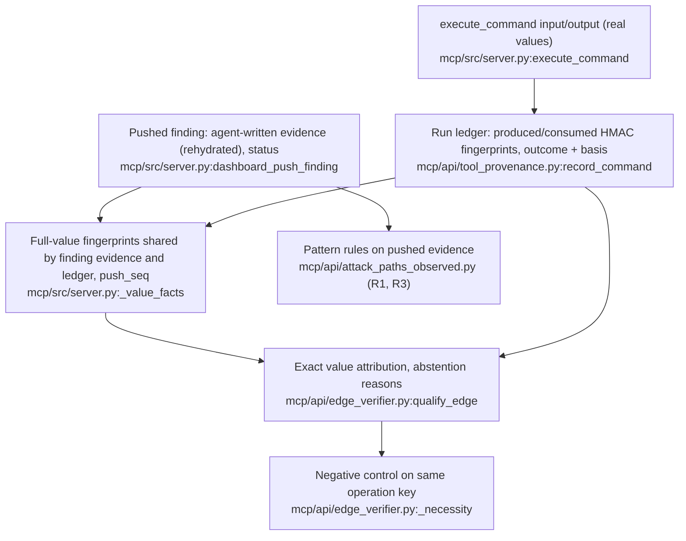

# Causality and evidence in DarkMoon attack paths

Status: public research documentation, version 1.0.0, 2026-11-20. Reconstructed read-only from code and internal reports. English. Conventions and labels are as in [`ATTACK-PATHS-ARCHITECTURE`](../architecture/README.md) §0:
- **Pro** = DarkMoon Pro, internal, `d6bfc0d9`;
- **Community** = [Dark-Moon `10eaab0`](https://github.com/ASCIT31/Dark-Moon/commit/10eaab0);
- `R/` and `D27/` = internal archives;
- `EXP-nnn` = forensic registry.

## 0. Position statement (read first)

- **DarkMoon does not have a universally reliable causal model of attack paths.** No component determines, across targets and protocols, that one finding *caused* or was *necessary for* another. [VERIFIED: every causal-verification approach failed its preregistered criterion, D27/07_results.md, D27/08_decision_records.md; 0 real-world qualifications under architecture D, R/51, R/54, R/60]
- **A graph plus an LLM does not demonstrate validated causal intelligence.**
  - The LLM agents propose links (`enabled_by`) with measured strict precision between 0.32 and 0.6 on single runs.
  - The graph engine assembles whatever links it is given and labels them by their weakest step.
  - Neither step validates causality. [VERIFIED: [EXP-042](../../experiments/successful/EXP-042.md), [EXP-043](../../experiments/inconclusive/EXP-043.md), [EXP-050](../../experiments/failed/EXP-050.md); `attack_paths.py:path_level`]
- **No multi-finding exploitation chain (N4) was ever proven on real data** under the strict definition below. [VERIFIED: D27 results, [EXP-015](../../experiments/failed/EXP-015.md), [EXP-024](../../experiments/failed/EXP-024.md), [EXP-031](../../experiments/failed/EXP-031.md); code comment in `mcp/api/attack_chains_evidence.py`: "an N4 downstream capability was proven necessary (there is NONE in the current evidence)"]
- What DarkMoon **can** state is narrower:
  - which links an agent *declared*;
  - which links a fixed server rule found in the evidence;
  - in principle, which values the server *recorded* flowing between two of its own executions;
  - when a refused attempt without the value was recorded, that the value was *necessary for that one request*.

## 1. Evidence vocabularies (three generations)

DarkMoon has used three overlapping vocabularies. They are not interchangeable.

### 1.1 Proof levels N1–N5 (Darkmoon 2027 design, Nov 2026)

These are defined in `D27/19_design/DESIGN.md` (lines 26–30, 64–70) and implemented in the flag-gated bridge `mcp/api/attack_chains_evidence.py` (`PROOF_LEVELS = ("N1", …, "N5")`, flag `DM_ATTACK_CHAINS`, **OFF by default**). The Angular model carries the type (`ProofLevel = 'N1' … 'N5'`). [VERIFIED]

| Level | Claim | Required evidence (summary of DESIGN.md) |
|---|---|---|
| **N1 Dependency** | "P produces a value that C reuses" | passive: the value first appears in a successful response of P, is absent from earlier requests and from operator-supplied values, then appears in a later request to C; P ≠ C |
| **N2 Precondition** | "the value is necessary for C" | counterfactual verdict `proven`, or the same request *without* the value refused (401/403) in the trace; 5xx / 404 / 400 → inconclusive |
| **N3 Proven vulnerability** | "a security property is violated on operation X" | an oracle verdict `proven` against a reference capability and, for authorisation, a reference permission set |
| **N4 Exploitation transition** | "the artefact from a proven vulnerability opens a capability beyond the reference on *another* operation" | (1) illegitimate provenance (same fingerprint as produced by the N3 exchange) + (2) N2 on C + (3) capability gain (C replayed with the reference artefact or none is refused) |
| **N5 Demonstrated impact** | "data or an action outside the reference capability is reached" | the response of an exchange or replay contains the impact element, outside the reference ("own scope" is not impact) |

**Path classes** in the bridge:
- `direct` = N3 + N5 on one operation, with coherent exchange ids and observed provenance;
- `chain` = additionally a proven N4 with a witness artefact;
- `dependency` = N1/N2 only, never an exploitation;
- `hypothesis` / `inconclusive` = anything else.

[VERIFIED: `attack_chains_evidence.py` lines ~19–21, 198–206, 250–281]

**Statistical bar set by the programme.** A class needs zero errors on at least **73 cases** for the 95 % Wilson upper bound to reach 5.00 % (6.02 % at n = 60). [OBSERVED: an internal topic-evidence note §2, design discussion; the E3 synthetic bench used 73 per negative class, EXP-027]

**Where N-levels were reached.**

| Level | Where reached | Label |
|---|---|---|
| N3 → N5 "direct" | on crAPI (`/.env` disclosure; vehicle BOLA). The BOLA required an evaluator-provided permission reference, so it is not black-box discovered | VERIFIED: [EXP-031](../../experiments/failed/EXP-031.md); an internal topic-evidence note §1, §2 |
| N4 | **never** on real data | VERIFIED |

### 1.2 Link states (architecture C/D, current)

Defined in `mcp/api/edge_verifier.py` and `CONTRACT-D` (R/51):
- `declared_by_agent` (C: `declared_unverified`);
- `observed_flow`;
- `causal_necessity_demonstrated`;
- plus `rejected_declaration` and `invalidated`.

See [`ATTACK-PATHS-ARCHITECTURE`](../architecture/README.md) §3.6. [VERIFIED]

**Mapping to N-levels.** This mapping is a HYPOTHESIS of this documentation; the code does not state it.
- `observed_flow` corresponds roughly to N1 restricted to server-recorded executions.
- `causal_necessity_demonstrated` corresponds roughly to N1 + N2 for one consuming operation.
- Neither checks N3 (an oracle on the security property) or N4 (a capability gain beyond a reference).

### 1.3 Product path kinds (Executive V2 legend, current UI and report wording)

In `mcp/api/exec_core/legend.py:path_kind_of`, mirrored in the Terminal Explorer `core.ts:pathKind`:
- **Evidence-Backed Attack Path.** Provenance `observed` (every link at least observed by a server rule or qualification), or `derived` with every claim corroborated *and* checked.
- **Possible Attack Path.** Everything else: `agent-declared`, `declared`, `inferred`, any `hypothesis: true`.

[VERIFIED]

Internally, `summary.proven_paths` counts the non-hypothesis paths. The schema name is kept for API compatibility. The paths-v2 decision says it must be documented as "observed flow", "never causality proven". [VERIFIED: R/40 DECISION.md "Decision"; `attack_paths.py` comment on `summary.proven_paths`]

## 2. Declared vs evidence-backed vs possible: the three categories

| Category | Sources (code) | What it asserts | What it does not assert |
|---|---|---|---|
| **Declared** (`declared_by_agent`, provenance `agent-declared`; operator-declared paths separately) | `live_push` + `declared_links` (agent); `infra/declare-path` (operator) | an agent (or operator) *says* B used A's result | that A's result was used, needed, or even produced |
| **Evidence-backed** (provenance `observed`; corroborated `derived`) | R1 and R3 in `attack_paths_observed.derive_observed_input`; D links qualified by `edge_verifier.qualify_edge`; RT-04 `_uncorroborated` | a fixed server rule matched the evidence, or the server recorded a value flowing between two of its own executions | causality, necessity (except `causal_necessity_demonstrated`), business impact, reproducibility |
| **Possible** (provenance `inferred`, R2 steps, any hypothesis) | `attack_paths_inferred.derive_inferred`; R2 block | a fixed rule finds the topology and confirmed findings *compatible* with a path | that anyone attempted it |

[VERIFIED: Pro d6bfc0d9]

## 3. What "proven" has meant over time

The word "proven" changed meaning several times. Older reports must be read with the definition in force at their date.

| Period | "Proven path" meant | Status |
|---|---|---|
| ≤ 2026-11-08 (paths v1) | R1/R2/R3 observed rule on the pushed evidence; 5 proven paths on 18 campaigns, all R3 "system account file" | SUPERSEDED for R2; R1/R3 meaning unchanged [VERIFIED: D27/02] |
| 2026-11-08 → | RT-04: a derived path is proven only if its claims are corroborated by the server | current [VERIFIED: `1f464407`] |
| 2026-11-11 (capstone) | an agent-declared finalisation chain whose every step is `exploited` | **SUPERSEDED** on 11-12 / 11-17 [VERIFIED: `2fe1c38f` vs `9a5b6bc2`, `f7d97ab4`] |
| 2026-11-17 (product-owner rule) | "a step is proven by observation alone" (R4 endpoint-bound flow, `39d5ec0c`); c5 "0 → 2 proven" | **SUPERSEDED**: both links were bound by declared URL only; 0 under C/D [VERIFIED: R/40 00-baseline.md] |
| 2026-11-17 → (C/D) | every link ≥ `observed_flow` (or R1/R3); worded "observed flow", never "causality" | current [VERIFIED] |
| 2026-11-19 → (Community) | never: `proven_paths = 0` by construction | current [VERIFIED: Community 10eaab0] |

## 4. What "evidence-backed / proven" does **not** mean today

1. **It does not mean causal.**
   - `observed_flow` says "the value left A's execution and reached B's successful execution", never "B needed it" (`edge_verifier.py` module docstring).
   - Necessity requires a recorded refused attempt *without* the value on the same operation key, in the same run, not compacted.
   - No real campaign has produced one.

   [VERIFIED]
2. **It does not mean independent of the agent's text for R1/R3.**
   - R1 and R3 match patterns inside the evidence fields that the agent wrote into `dashboard_push_finding`. These fields are server-rehydrated from placeholders, but transcribed by the agent.
   - Only `qualify_edge` uses the independent run ledger.
   - So an R3 step ("response contains `root:x:0:0`") rests on the agent's transcription of a response, not on a server capture. [VERIFIED: `derive_observed_input` reads `v["evidence"]`; `_declared_ledger` is the only ledger reader in the D block]
   - Whether placeholder rehydration makes fabrication materially harder for R3 patterns is **UNKNOWN**. A literal string can be typed. [HYPOTHESIS]
   - Two texts overstate this point (see [`ATTACK-PATHS-ARCHITECTURE`](../architecture/README.md) §5 item 6): the Explorer's "every step backed by evidence the server recorded", and the Community docstring's statement that Pro evidence "comes from the server's own recording". [VERIFIED: code read]
3. **It does not mean the path is complete or the only one.**
   - Assembly is bounded: depth ≤ 6, ≤ 100 chains, a time budget, simple paths only.
   - The inferred layer is capped at 40.
   - Truncation is reported (`bounded_chains` stop reason). [VERIFIED]
4. **It does not mean "fixing X breaks the attack".**
   - The simulation is labelled "SIMULATION · not applied".
   - Fix first "breaks the chain" only through `causal_necessity_demonstrated` edges; otherwise it is "removes an observed route" (paths-v2 decision).
   - The greedy top-k ranking is not optimal: k = 5 regret was > 0 in 36.5 % of synthetic instances. [VERIFIED: `attack_paths.SIMULATION_LABEL`; R/40 DECISION.md; SIMULATED: EXP-011]
5. **It does not mean reproduced.** Retests can interrupt a path, but a proven path is not re-executed by the engine. [VERIFIED: `routes_attack_paths._retest_verdicts`; Community has no retest store]
6. **It does not transfer across targets.** Every precision figure in this programme comes from one target per run, and finding counts are not comparable across targets. [rule of this programme]

## 5. Evidence model in architecture D (what the server can know)

**Outcome classification** (`edge_verifier`):
- success requires `http_2xx` or `exit0_expected_output`;
- refusal requires `http_refused` or `refusal_signature`;
- `exit 0` alone gives `unknown`.

[VERIFIED: `SUCCESS_BASES`, `REFUSAL_BASES`]

**Abstention is the expected outcome on real data.** The reasons are a closed set (`D_REASONS`). On the replayed real campaigns:
- c5: 15 `no_shared_value`, 1 `session_unknown`;
- c6: 9 `no_shared_value`.

[SIMULATED replay: R/51 SERVER-ATTRIBUTION.md, REPLAY-C5-C6.json]

## 6. Anonymised evidence and its effect on proof

- **What anonymisation does.**
  - The Privacy Gateway replaces secrets, hosts and URLs with placeholders before the model sees them.
  - After the c6/c7 leak of a lab SSH key, key blocks and table-cell secrets were also tokenised (`63164ac9`, `44a20255`), and the sanitizer fails closed (`64d72147`). [VERIFIED]
- **How agents write evidence.** Agents mask credentials themselves in evidence: `***` in 8 of 11 c6 pushes, and mask marks in 16 of 39 c5 pushes. **0 of 50** real pushes contain a non-host placeholder. [VERIFIED: R/52 PROVENANCE-STUDY.md]
- **Consequence.** Neither value-level nor placeholder-level attribution can link findings on real data. [VERIFIED: R/52]
- **Unexplored option.** The study notes that the server *could* record which execution minted a placeholder, by passing the exec id into the sanitiser. This would help only the execution side; the push side is empty. It is not implemented. [OBSERVED: R/52 §(a)]
- **The trade-off.** Stronger model-side privacy and stronger server-side attribution compete for the same evidence. No design in the sources resolves this. [HYPOTHESIS]
- **Privacy residuals noted in the sources.** The sources document a small number of remaining masking gaps (some identifier and key shapes), tracked internally; one gap found during a Community run (an address decoded from kernel network tables) was fixed. They are relevant here because they show the evidence path is still evolving. [OBSERVED: R/66 07-DVGA.md; R/55 §8]

## 7. Validation methods used, and what each can show

| Method | Can show | Cannot show | Examples |
|---|---|---|---|
| Sealed deterministic harness + independent oracle | the engine never promotes on adversarial cases (false-promotion rate on the scenario set) | real-world precision or recall of agents | harness-d 0 false promotions, recall 0.867 ([EXP-049](../../experiments/adversarial/EXP-049.md)) |
| Mutation testing | the tests constrain the rules (permissive mutants killed) | the rules are right for real data | 95.2 %, 0 permissive ([EXP-049](../../experiments/adversarial/EXP-049.md)) |
| Replay of stored real campaigns | what the current engine would decide on past data | what agents would declare under new prompts | c5/c6 0 qualified ([EXP-047](../../experiments/adversarial/EXP-047.md)) |
| Proxy-model simulation (Claude Code sub-agents) | the *direction* of prompt effects on given transcripts | campaign-model behaviour; variance is ±20 pt | [EXP-051](../../experiments/failed/EXP-051.md), [EXP-053](../../experiments/failed/EXP-053.md) |
| Real campaign + independent oracle | declared-link precision and recall on that target, n = 1 | generalisation; intervals overlap | c6, c7 ([EXP-043](../../experiments/inconclusive/EXP-043.md), [EXP-050](../../experiments/failed/EXP-050.md)) |
| Counterfactual replay (CF, E4) | N2/N4 for specific candidates on a lab | anything without lab-side permission references; it is active and needs authorisation | CF-CONFIRM 1 of 18 ([EXP-024](../../experiments/failed/EXP-024.md)); E4 0 N4 ([EXP-031](../../experiments/failed/EXP-031.md)) |
| Blind adjudication | the truth of specific claims | coverage | ADJ1–3 ([EXP-021](../../experiments/adversarial/EXP-021.md)) |

[Labels per EXP entry in [`ATTACK-PATHS-EXPERIMENTS`](../../experiments/RESULTS.md)]

## 8. Summary of what is and is not demonstrated

**Demonstrated.**
- On synthetic and sealed scenarios, the server never promoted a declared link it should not have:
  - 0 false promotions across harness-d runs;
  - 0 false proofs on 66 critical negatives for C.

  [SIMULATED: [EXP-044](../../experiments/adversarial/EXP-044.md), [EXP-047](../../experiments/adversarial/EXP-047.md), EXP-049]
- Agents declare some correct links on real multi-protocol runs. Strict precision was 0.32–0.6 and strict recall 0.33–0.83 (n = 1 per run). [VERIFIED]
- Specific single-step exploitations with demonstrated impact were shown on a lab (crAPI direct N3 → N5). [VERIFIED: EXP-031]

**Not demonstrated.**
- Any real-world `observed_flow` or `causal_necessity_demonstrated` link. [VERIFIED: 0 on all scored runs]
- Any real N4 chain. [VERIFIED]
- That declared-link precision is stable or improvable by prompt wording. [SIMULATED: NO-GO studies]
- That the "Fix first" ranking reflects causal leverage on real data rather than the structure of declared or observed links. [HYPOTHESIS]
- Cross-target generalisation of any figure. [UNKNOWN]
