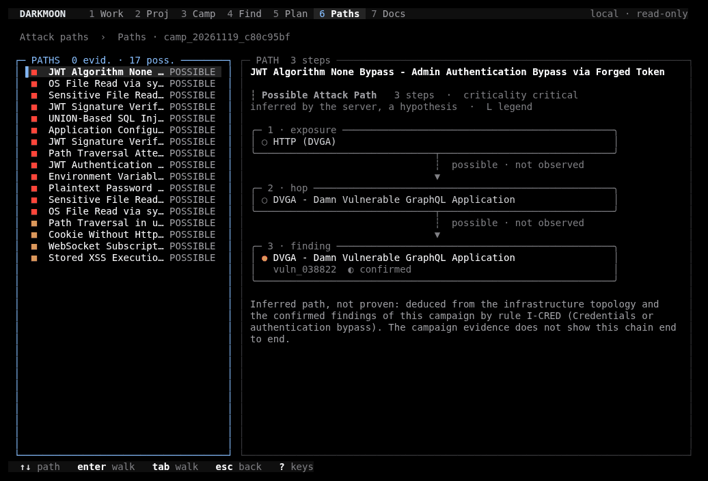
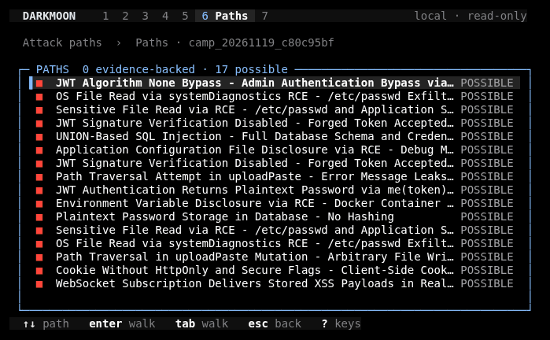
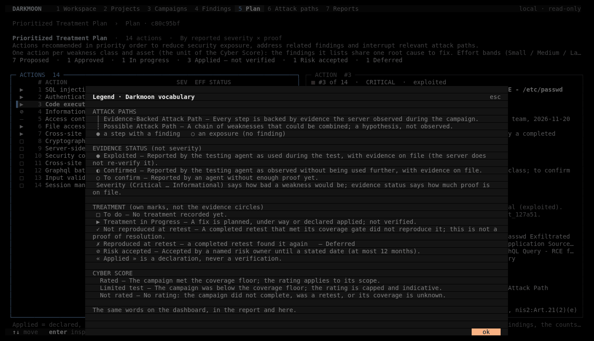
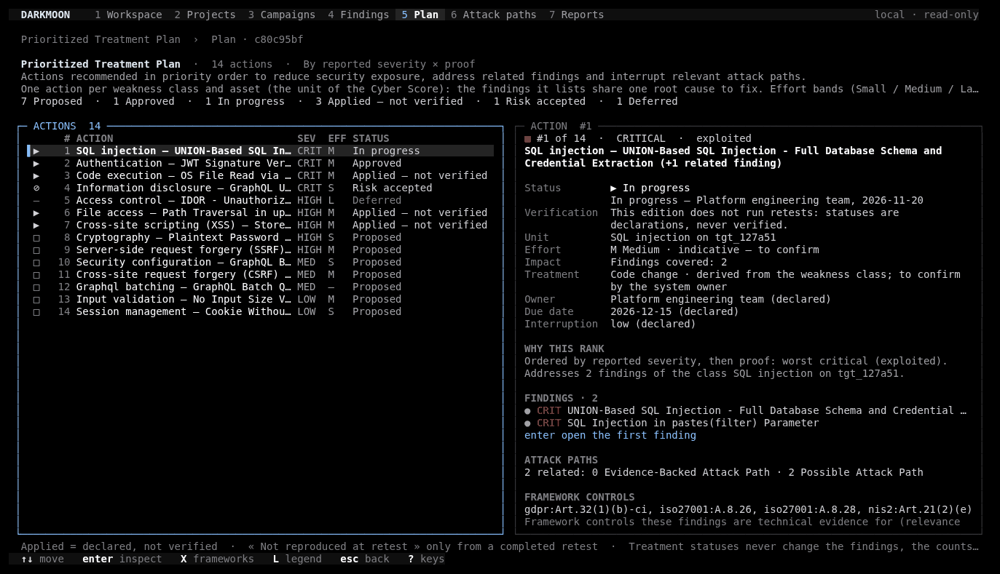

# Screenshots

Only images that show **synthetic demo data** are published here. Each image has a `*.metadata.json` file with product, version/commit, date, data source, dimensions, description and status.

| Image | Shows |
|---|---|
|  | Terminal Explorer, Attack paths tab (Community): 0 evidence-backed, 17 possible; a 3-step Possible Attack Path inferred by the server |
|  | Same list at 80×24 |
|  | Legend: Evidence-Backed vs Possible Attack Path, evidence status, treatment marks |
|  | Prioritized Treatment Plan ordered "by reported severity × proof" because no Evidence-Backed path exists |

**Data source.** A demo seed made from an anonymised copy of a lab campaign against DVGA (a public, intentionally vulnerable GraphQL application) plus synthetic overlays (treatment statuses, owners, due dates, application profile) labelled SYNTHETIC DEMO DATA in the data itself. Captured from the real `opencode-darkmoon` 1.19.6 binary with model providers disabled.

**Known wording issue visible in the legend.** "Every step is backed by evidence the server observed" overstates the code for R3 steps, which match agent-written evidence text (see [limitations](../docs/limitations/README.md#3-engineering-limits)).

**Compression.** Palette quantisation to 128 colours with Pillow (pngquant/optipng unavailable); text remains sharp.

Excluded on purpose: web-dashboard captures and Pro terminal captures from the same session, because they display an internal lab hostname.
